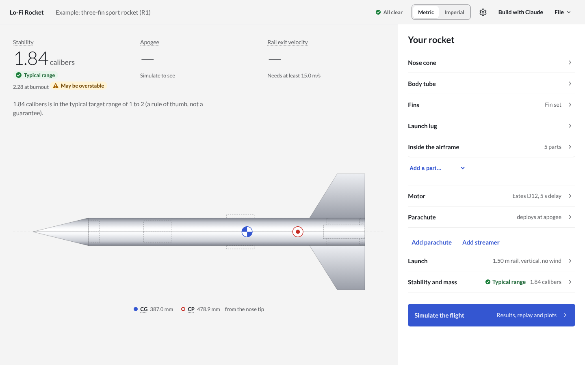
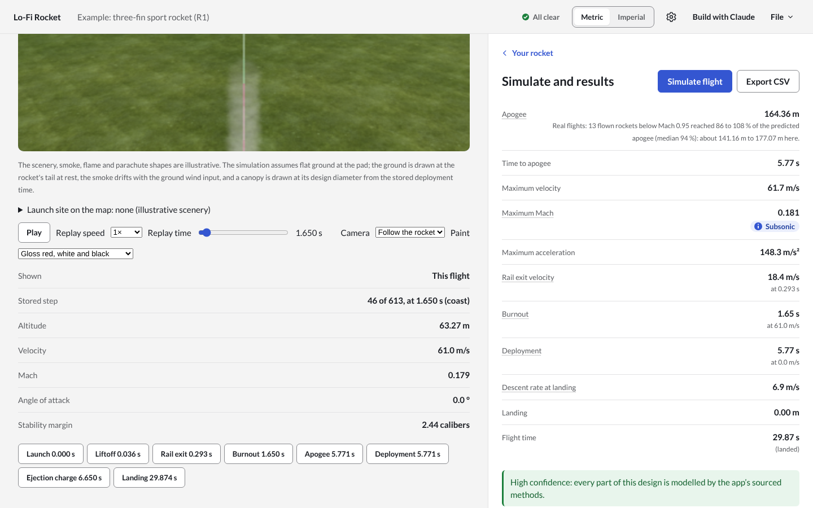

# Lo-Fi Rocket

[](https://github.com/ahroonsanthosh/lo-fi-rocket/actions/workflows/ci.yml)
[](https://github.com/ahroonsanthosh/lo-fi-rocket/actions/workflows/deploy.yml)
[](https://github.com/ahroonsanthosh/lo-fi-rocket/actions/workflows/codeql.yml)
[](LICENSE)

**A rocket design and flight simulator where every number comes with its source, its proof and how far to trust it. Free, and it runs in the browser.**

**[Open the simulator](https://ahroonsanthosh.github.io/lo-fi-rocket/)**: no install, no account.



Amateur builders use simulators to decide whether a rocket is stable, whether it leaves the rail fast enough, and where it will land. Today's tools are hard to learn, and they rarely say how far their numbers can be trusted. Lo-Fi Rocket is built the other way round:

- **Accuracy you can check.** Each of the 145 equations is cited to a page of a published source and has tests, with expected values worked by hand or in an independent tool. The results are validated against wind-tunnel data, 24 real flights and two other simulators, and every difference is reported and explained, including issues found in OpenRocket ([`docs/reports/openrocket-issues.md`](docs/reports/openrocket-issues.md)).
- **Honest about its limits.** Every result lists its approximations and a confidence rating, and says what a barometric altimeter will read on the day. Warnings are in plain language.
- **Easy, and free.** Design live with stability updating as you type, then fly in six degrees of freedom with a 3D replay, Monte Carlo landing zones and real launch-site maps. Imports OpenRocket `.ork`, RASAero II `.CDX1`, and motors from `.eng`, `.rse` and ThrustCurve.org. Runs in the browser and costs nothing.



## Build with Claude

Press **Build with Claude** in the top bar. Copy the prompt into any Claude app, describe your rocket (or attach a photo, a parts list or a file), and paste Claude's answer back. The site checks it, builds the rocket and flies it, in your browser, on your own Claude plan, at no cost. Every value Claude estimated, and every value left out, is listed with the result.

For Claude to drive the simulator directly, an MCP server is available for Claude Desktop and Claude Code (File > Use with Claude).

## How it is built

One developer directing several Claude Code agents, each in its own lane (physics, UI, 3D replay, review), working in parallel through pull requests:

- **Rules first.** [`CLAUDE.md`](CLAUDE.md) sets the non-negotiables: no physics from memory, a source for every equation, tests in the same change, never tuning constants to fit data.
- **Plan, decide, record.** Every task starts as a written plan ([`docs/plans/`](docs/plans/), 86 so far). Every modelling choice is a numbered decision with its reason ([`docs/decisions.md`](docs/decisions.md), 130 so far). Conflicts between sources go to the owner.
- **Proof on every change.** About 1,900 unit, property-based and reference tests, browser end-to-end tests under the site's security policy, and CodeQL. Each merge redeploys the site.

## Getting started

```sh
pnpm install
pnpm --filter @lo-fi-rocket/app dev    # the application in the browser
pnpm check                              # typecheck, lint, format check and every test
```

Node 22.12 or later and pnpm 10 are required.

The code lives in six packages:

- `packages/physics`: the simulation engine. It is pure TypeScript with SI branded units and no UI.
- `packages/formats`: file readers and writers (.eng, .rse, .ork, .CDX1, CSV, the app's own format).
- `packages/app`: the React application.
- `packages/ui`: the design system.
- `packages/viewer`: the 3D replay and launch-site maps.
- `packages/mcp`: the Claude integration (the MCP server and the paste box's builder).

The documentation lives in `docs/`:

- `equations.md`: every equation, with its source, validity and tests.
- `decisions.md`: every modelling choice, with the reason.
- `known-limitations.md`: what each model does not capture.
- `reports/`: the validation reports.
- `future-work.md`: what v1.0 leaves out.

## What you can trust

The numbers below come from the tests and reports named beside them. They are the agreement found on the cases tested, not a guarantee for every design.

| Result                                                  | Agreement                                                                                                                                                                                             | Evidence                                                                 |
| ------------------------------------------------------- | ----------------------------------------------------------------------------------------------------------------------------------------------------------------------------------------------------- | ------------------------------------------------------------------------ |
| Atmosphere (U.S. Standard Atmosphere 1976, −5 to 86 km) | the published tables to their printed precision                                                                                                                                                       | `docs/reports/phase-1-acceptance.md`                                     |
| Mass, CG and static CP of the five reference rockets    | CG within 0.0004 % of OpenRocket; every component CP equals the source's closed form within 10⁻⁸ (OpenRocket's 0.016 to 0.034 % differs by its numerical integration, issue 7)                        | `docs/reports/phase-1-acceptance.md`, `cp-closed-form.reference.test.ts` |
| CP against measured data, Mach 0 to 0.8                 | 0.4 % of body length rms (worst 0.5 %)                                                                                                                                                                | `docs/reports/held-out-validation.md`                                    |
| CP against measured data, Mach 0.8 to 1.2               | 4.3 % of body length rms (worst 6.4 %)                                                                                                                                                                | same                                                                     |
| CP against measured data, Mach 1.2 to 2.0               | 3.1 % of body length rms (worst 3.7 %)                                                                                                                                                                | same                                                                     |
| Drag coefficient against measured data, subsonic        | 6.7 % rms (target 7 %, D-120)                                                                                                                                                                         | same                                                                     |
| Apogee, maximum velocity, rail-exit velocity            | in the OpenRocket-equivalent mode, apogee within 3 %, maximum velocity within 1 %, rail exit within 0.3 % of OpenRocket; in the displayed mode, apogee within 3.6 % and maximum velocity within 1.7 % | `simulate.openrocket.test.ts`, `docs/reports/large-angle.md`             |
| Integration                                             | step-size convergence shown; RK4 and Dormand–Prince agree; the RK4 step is checked against the stability limit of every mode at every step                                                            | `docs/reports/phase-2-acceptance.md`, `docs/reports/rk4-step-check.md`   |
| Determinism                                             | the same inputs give bit-identical outputs; Monte Carlo seeds are saved                                                                                                                               | golden-file tests                                                        |

**Trust with care:**

- **Transonic and supersonic drag.** It is 20 % (transonic) and 15 % (supersonic) rms from measured data. Apogees of rockets that pass Mach 0.8 are correspondingly less certain. The app warns in those regimes.
- **Apogee of real amateur rockets (plan 0080, the project's first priority).**
  - **The benchmark.** All 24 flown rockets among RASAero II's examples are flown on every change (`docs/reports/real-flights.md`, D-119).
  - **The gap.** Each flight is compared as its own instrument reads it: a barometric altimeter reads low on a hot day, because it assumes the standard atmosphere (D-121). On that basis the displayed apogee is +5.3 % on average on the 13 flights below Mach 0.95 (target ±3 %) and +18.0 % on the 11 above, where the transonic drag is the known weak point. RASAero II, compared the same way (its apogees converted to a barometric reading with this simulator's atmosphere, ATM-13), is −5.4 % below Mach 0.95: it predicts too much drag where this simulator predicts too little.
  - **Your altimeter.** Every result says what a barometric altimeter will read when the day is not standard.
  - **Until then,** every flight result shows beside its apogee the range that measured flights of its speed range reached.
- **Above Mach 2.** Nothing has been validated there; every result says so.
- **In-flight stability margin.** It uses the more conservative of two normal-force models at angle of attack. Real long, slender rockets have shown a larger forward CP shift than either model predicts (D-070).
- **Large angles of attack.** Tumbling and backward flight above 60° use DATCOM correlations with no test verification there. They are approximate and flagged.
- **Fin flutter.** The check uses NACA TN 4197, an empirical criterion with a shaded safe/unsafe band. A flutter-speed ratio near 1 is uncertain either way, and fibreglass has no sourced shear modulus.
- **Warning thresholds.** The stability, rail-exit, thrust-to-weight and deployment-speed limits are rules of thumb. They are editable, and they are not guarantees.

- **Multi-stage, clustered and podded rockets.** They fly, with their approximations listed:
  - a stage separates instantly, with no separation impulse, and leaves with everything below it (D-091);
  - a cluster's motors ignite together (D-086);
  - pods are counted one by one, with no interference between them and the body (D-106).

  A motor in a pod is not supported yet.

- **RASAero II `.CDX1` files.** They import and export (D-114, D-116). What RASAero cannot hold is refused or listed.

**Do not rely on these for v1.0:**

- the flight path and landing of a separated booster (not simulated);
- combustion modelling of liquid engines (only imported thrust and mass profiles).

## Licence and sources

MIT ([`LICENSE`](LICENSE)). The OpenRocket reference harness in `tools/openrocket-harness/` is GPLv3, separately; nothing in `packages/` depends on it.

OpenRocket (GPLv3) was used only as a black box to produce reference outputs; none of its source code was read or translated. The physics follows the documents listed in `CLAUDE.md` section 4 and `reference/`.
