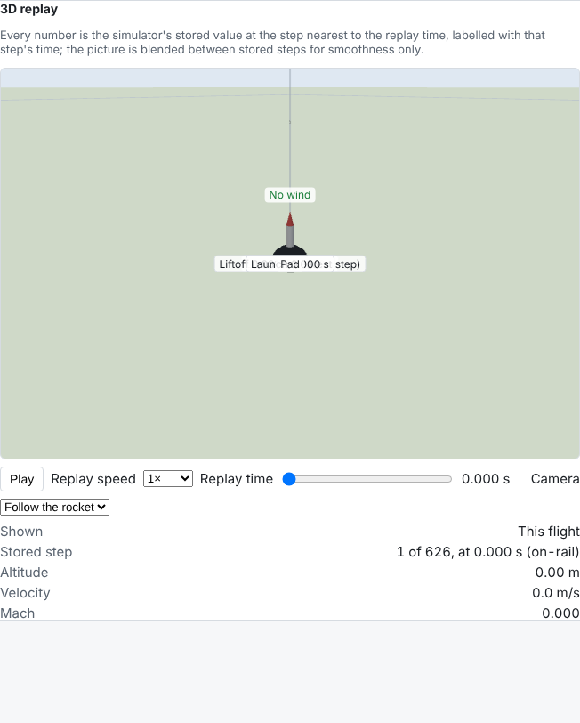
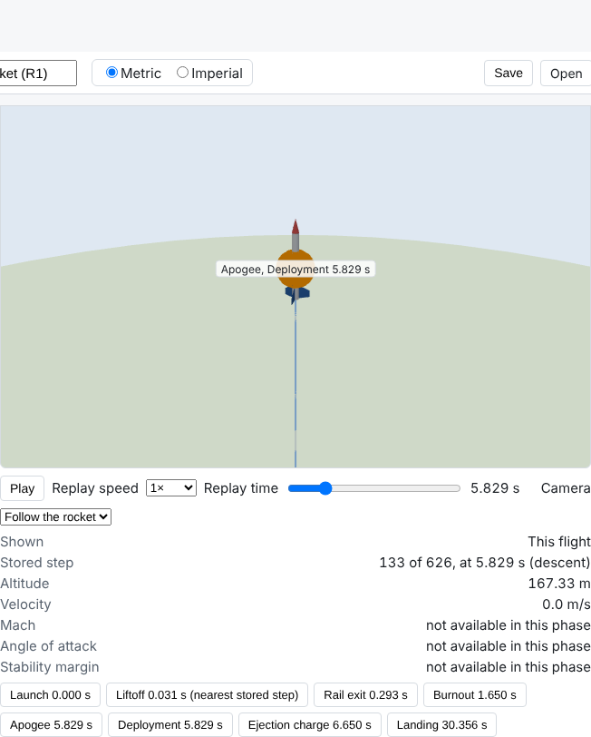
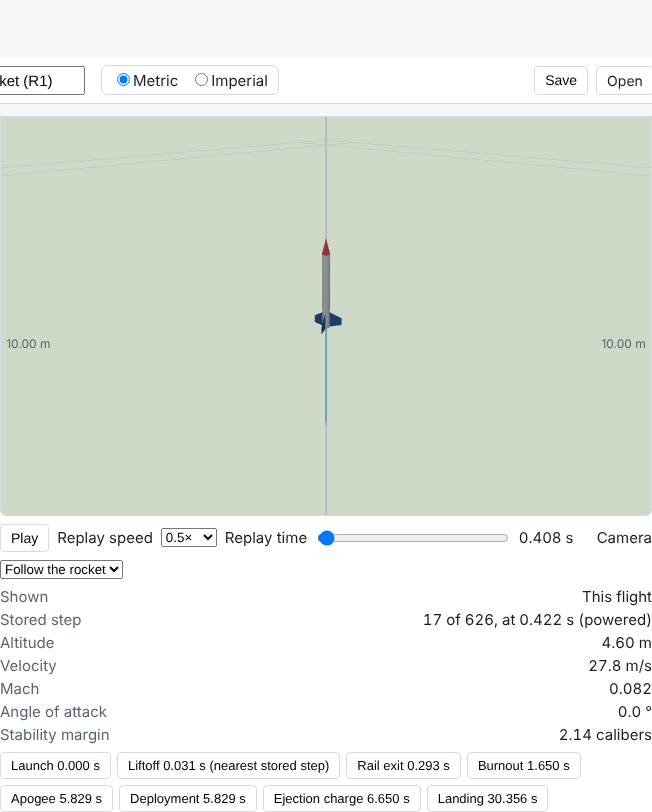
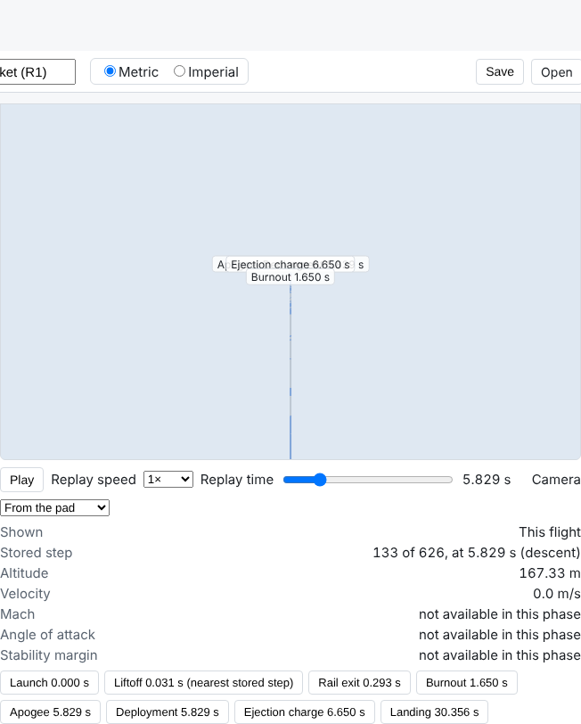
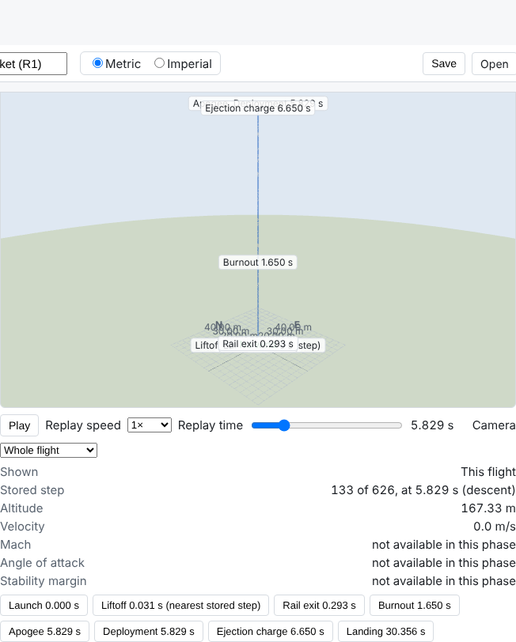
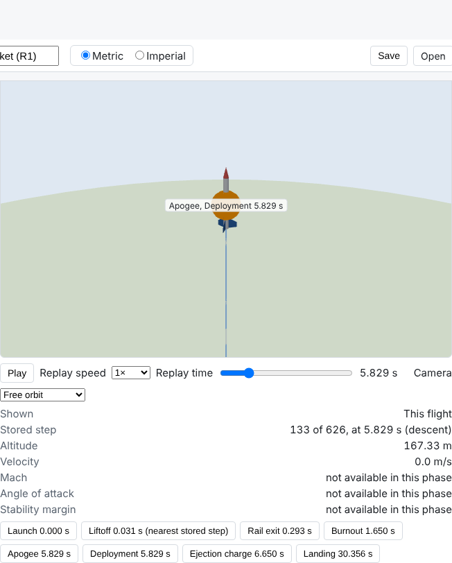
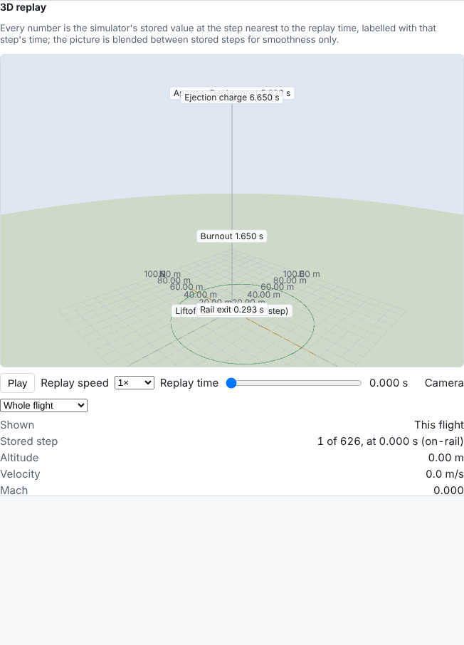
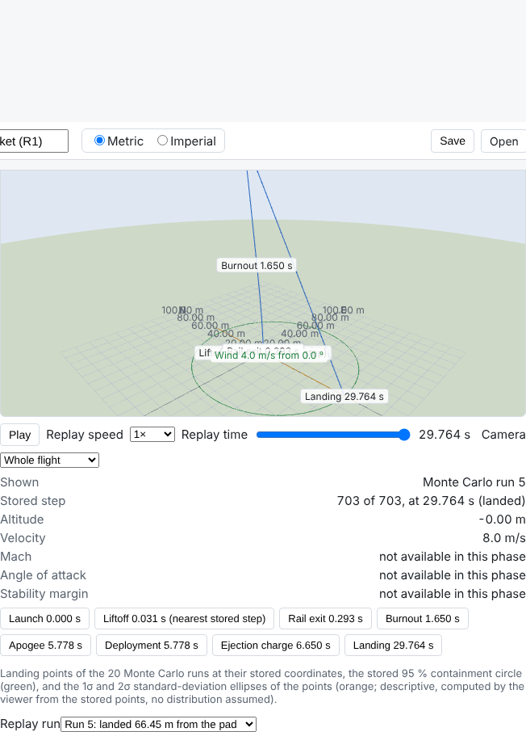

# 3D viewer report (plan 0024)

Date: 2026-10-12. Branch `feature/3d-viewer`, from the head of `claude/inspiring-tesla-xxp0hh` (109d117). Produced under autonomous mode (CLAUDE.md section 11). Nothing in `packages/physics`, `packages/formats`, `CLAUDE.md`, `docs/equations.md`, `docs/known-limitations.md` or `reference/` was changed.

## What was built

A new package, `packages/viewer` (three.js 0.186.1), consumed by `packages/app` as the "3D replay" section under the flight plots. It replays a `FlightResult` exactly as the simulator computed it and computes no physics (D-060):

| Requirement                                             | Where                                                                                                                                                                                                                                                                                                                       |
| ------------------------------------------------------- | --------------------------------------------------------------------------------------------------------------------------------------------------------------------------------------------------------------------------------------------------------------------------------------------------------------------------- |
| 3D model from the design's geometry, to scale           | `geometry/rocket-model.ts`: nose cones and transitions revolved from the physics profiles (GEO-1, GEO-2), body tubes, trapezoidal fins (fin 1 at +y, 2π/n apart), launch lugs and rail buttons; origin at the nose tip; metres                                                                                              |
| Replay of position and attitude from the stored samples | `scene/flight-scene.ts`: the scene is the flight frame (east, north, up); the stored quaternion is the object's rotation; the stored position (the CG) carries the model by the stored CG offset                                                                                                                            |
| Play, pause, speed, scrubber                            | `replay/clock.ts` (`ReplayController`, 0.1× to 4×) and the app's `FlightViewer.tsx`                                                                                                                                                                                                                                         |
| Interpolation for the picture only; numbers from a step | `displayPose` blends between the two neighbouring stored steps for the drawing; `readoutsAt` returns the stored sample of the nearest step by reference, with its time                                                                                                                                                      |
| Path, event markers, rail, grid with scale, wind arrow  | the scene: a polyline through every stored position (the flown part highlighted), a marker at each event's stored step, the rail from the physics `railDirection`, a 1-2-5 grid with distance labels in the app's units, an arrow along the ground wind velocity                                                            |
| Live readouts                                           | altitude, velocity, Mach, angle of attack, stability margin (and the phase), each the stored value of the step shown, labelled "stored step k of N, at t"; NaN values of the descent shown as "not available in this phase"                                                                                                 |
| Cameras                                                 | follow, from the pad, whole flight (overview), free orbit (OrbitControls)                                                                                                                                                                                                                                                   |
| Monte Carlo                                             | `dispersion/landing-scatter.ts`: every landed run at its stored coordinates, the stored 95 % containment circle, the 1σ and 2σ covariance ellipses of the stored points (descriptive, labelled as computed by the viewer); a run picker that re-runs the simulator on the identical perturbed design and replays the result |
| Units at the display boundary                           | the viewer formats nothing itself; the app passes a `Formatter` built on `formatQuantity`, so the metric/imperial toggle applies to the readouts and the scene labels                                                                                                                                                       |

## Accuracy checks

All in `packages/viewer/src/**/*.test.ts` (90 tests) and `packages/app/src/components/FlightViewer.test.tsx` (3 tests), run by `pnpm test`:

- **Displayed values are the stored values.** For all five reference rockets (the `.ork` and `.eng` files of `reference/`, flown through `simulateFlight` in the OpenRocket-equivalent modes at 0.002 s with 5 m/s of wind and a tilted rail), at every event and at every 25th step: the readouts are the stored sample by reference, every field `Object.is`-equal, the readout time the stored time; the apogee readout equals the summary apogee and its time the time to apogee; the landing marker's distance equals the summary landing distance; the descent samples show no stability margin.
- **Event markers.** Each marker is at the stored step whose time is within 1e-9 s of the event (the simulator's own timed-event drift is about 1e-12 s); only liftoff, which the simulator does not record separately, falls back to the nearest step and is flagged in the label and the event list.
- **Model dimensions.** R1 by hand from `reference/rockets/README.md` (nose 0.100 m long, radius 0.025 m, on the conical profile; tube 0.100 to 0.600 m; three fins with corners (0.5, 0.025), (0.55, 0.105), (0.6, 0.105), (0.6, 0.025), 120° apart; lug 0.350 to 0.400 m at the body surface; length 0.600 m, maximum radius 0.105 m). All five rockets: the model's length equals the aft-most drawn point and its radius the largest outline, every curved outline point lies on the physics profile, every fin of every set is drawn.
- **Rendered orientation.** For all five rockets at every 20th step: the rocket object's nose axis in the scene (body −x through the object's world matrix) equals the physics `noseDirection` of the stored quaternion within 1e-12 in each component; the object's position is the stored position bit for bit; the nose tip is the stored CG offset along that axis within 1e-12 m; on the rail the axis is the rail direction of DYN-6.
- **Clock, grid, cameras, statistics by hand.** Nearest-step and tie rules, the display blend (a 90° roll halfway between identity and a 180° roll), play/pause/speed/seek; grid spacing cases; the follow, pad and overview camera placements; the covariance ellipse on two 4-point samples (axes √(8/3) and √(2/3) at 90°; √(4/3) and √(1/3) at 45°).
- **In the app (jsdom).** Seeking to the apogee event shows the flight panel's apogee value and the stored step's time; the burnout step shows the stored Mach, angle of attack and margin; the units toggle converts the readouts; a Monte Carlo run with zero variations replays the same stored flight labelled as the run.
- **End to end (Playwright, Chromium, `packages/app/e2e/viewer.spec.ts`, 2 tests).** The canvas renders (no WebGL fallback message); the apogee readout equals the flight panel's figure; the cameras switch; playback advances through the powered phase; the imperial toggle shows feet; a 20-run batch with a 2 m/s wind spread shows its landing points and replays run 5.

## Screenshots

Taken by the end-to-end tests with `VIEWER_SCREENSHOTS=1` (the example design, R1 with the Estes D12, no wind).

| View                                              | Image                                          |
| ------------------------------------------------- | ---------------------------------------------- |
| On the rail at the start, follow camera           |            |
| Apogee step: altitude 167.33 m at 5.829 s         |          |
| Powered flight during playback                    |        |
| From the pad                                      |                |
| Whole flight                                      |      |
| Free orbit                                        |            |
| Monte Carlo landing points and containment circle |  |
| A replayed Monte Carlo run at its landing step    |                |

## Limitations and requests (no physics changed)

- `FlightResult` stores no wind; the arrow is the design's ground wind (the simulator's input). A `modes.wind` record would make a stored result self-describing.
- `DispersionRun` stores no time series; replaying a run re-runs the simulator on the identical perturbed design (deterministic). An optional stored result would avoid the second run.
- `DispersionSummary` has no ellipse; the viewer's covariance ellipse is descriptive statistics on the stored points, labelled as such.
- Recovery devices are not drawn (the result stores no canopy state); internal components are not drawn; lugs and buttons are drawn at +z because the design records no angular position for them.
- Liftoff has no stored step of its own and is shown at the nearest step, flagged.
- Found while testing, outside this plan's scope: RK4 at a 0.01 s fixed step is unstable for R2 (D-060); the app's default integrator is Dormand–Prince and is unaffected.

## Checks

`pnpm check` clean (typecheck, lint, format, every test); the app builds; the Playwright suite (5 tests) passes with the container's Chromium (`PLAYWRIGHT_CHROMIUM_PATH=/opt/pw-browsers/chromium`).
