# Redesign plan

**Date:** 2026-10-12. Plan UI-0001; decisions D-UI-1 to D-UI-5 in `docs/ui/decisions.md`.
**Inputs:** the usability review (`docs/ui/review.md`), CLAUDE.md sections 8 and 9, the owner's brief for this prompt.
**Status:** applied to `packages/app` on 2026-10-13 in the look of the owner's reference image, an instrument console (section 12, D-UI-6 to D-UI-10). The sections below remain the rules; section 12 says where each part landed and what was adapted.

## 1. Principles

1. **Nothing the simulator produces is changed, rounded differently or hidden.** Every figure goes through one table of display rules (section 8), which reproduces today's rounding exactly and is tested against the app's code.
2. **Safety information is never harder to see than today.** Warnings move from inside editors to a column that is visible on every screen; none can be dismissed; acknowledging one only records that it was read.
3. **Plain words first, references second.** Each warning leads with what happened and why it matters; the source or decision number follows on a smaller line. Every technical term has a tooltip saying what it means and what a good value looks like.
4. **Guided, never gated.** New users get an ordered path; every step stays open to experienced users, who can hide the guide.
5. **Meaning is never carried by colour alone.** Every status has an icon shape and a word as well.

## 2. Information layout

The page has five areas (`AppShell`): a header, a status bar, the navigation, the main view and the checks column.

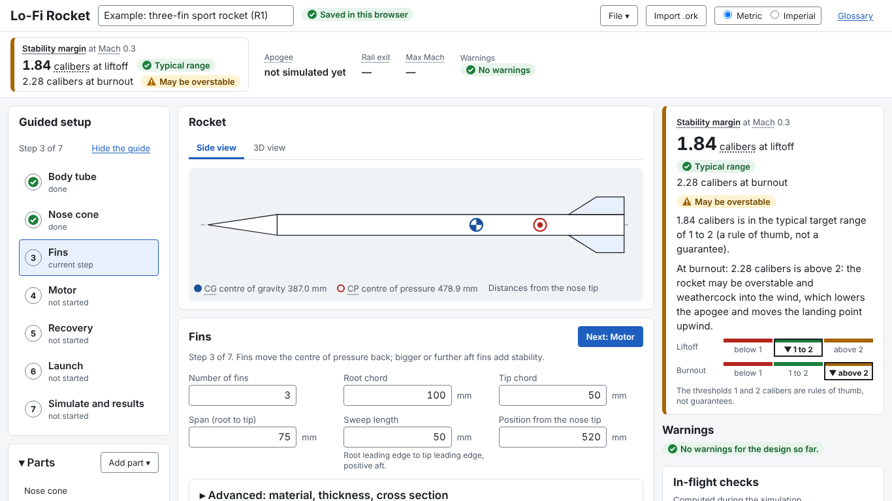

### Always visible (every screen, never scrolls away)

| What                                                                                                                         | Where               | Component                                        |
| ---------------------------------------------------------------------------------------------------------------------------- | ------------------- | ------------------------------------------------ |
| Stability margin at liftoff and burnout, each with its status in words                                                       | status bar (sticky) | `StabilityIndicator compact`                     |
| Apogee, rail exit velocity, maximum Mach of the last flight, or "not simulated yet"; "out of date" when the design changed   | status bar          | `StatusItem`                                     |
| Warning counts by severity and the most serious warning's title                                                              | status bar          | `WarningSummary`                                 |
| The full stability card: both margins, the physics' guidance sentences, the zones of the thresholds, the rules-of-thumb note | checks column, top  | `StabilityIndicator`                             |
| Every current warning and notice, in full                                                                                    | checks column       | `WarningList`                                    |
| In-flight checks: minimum in-flight margin, fin flutter margin                                                               | checks column       | `Panel` with `ResultCard`s (reserved, section 6) |
| Design name, saved state, File menu, Import .ork, units, theme, glossary                                                     | header              | `Button`, `FileButton`                           |

The checks column is the right-hand column at 1100 px and wider. Below 1100 px the columns stack and the checks come directly after the status bar, before the steps and the editor (`after-problems-narrow-full.png`).

### One click away

| What                                                                                                     | Where                                                        |
| -------------------------------------------------------------------------------------------------------- | ------------------------------------------------------------ |
| The guided steps and the parts list                                                                      | navigation column                                            |
| Side view and 3D view                                                                                    | tabs at the top of the main view (`Tabs`)                    |
| The editor of the selected step or part                                                                  | main view, under the rocket view                             |
| Full flight results: every summary figure, the four plots                                                | main view, results step (`ResultGrid`)                       |
| Events, "How this was computed" (the modes line), Monte Carlo, recorded flight data, imported drag curve | collapsible panels in the results view (`Panel collapsible`) |
| Motor sources (library, ThrustCurve.org, .eng/.rse, CSV)                                                 | tabs in the motor step                                       |
| Stored designs, Open, Save, New, Load example                                                            | File menu                                                    |
| Glossary                                                                                                 | every underlined term, and the Glossary button in the header |

### Advanced settings (collapsed by default, labelled "Advanced")

Material and density overrides, wall thickness, fin cross section; simulation settings (integrator, tolerance or step, maximum time, recording interval); warning and stability thresholds (labelled "rules of thumb; they change no physics", as today); turbulence seed; motor overhang. A collapsed advanced panel never contains a warning: a warning raised by an advanced setting goes to the checks column like any other.

### Results belong to a design

Replacing the design (New, Open, Load example, Import .ork, a stored design) clears the flight results and the Monte Carlo results. Editing the design keeps them but marks every result card, the status bar and the plots "out of date" in words, with a dashed border, until the next simulation (review finding 1).

## 3. Guided path

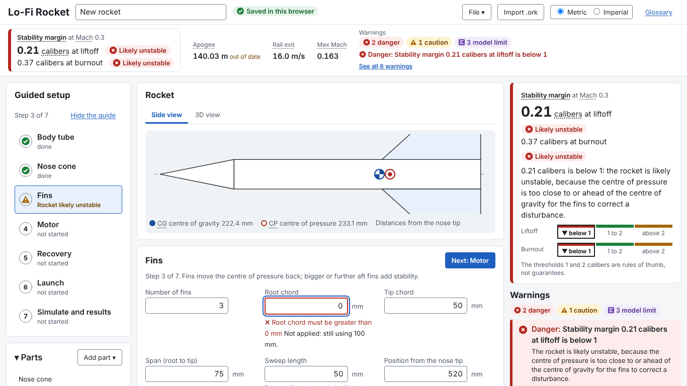

Seven steps, shown as a numbered list in the navigation column (`StepGuide`):

| Step | Opens                                   | Done when (decided by the app)                                                       | Says                                                                                                                  |
| ---- | --------------------------------------- | ------------------------------------------------------------------------------------ | --------------------------------------------------------------------------------------------------------------------- |
| 1    | Body tube                               | a body tube exists                                                                   | "The body sets the reference diameter that stability is measured in."                                                 |
| 2    | Nose cone                               | a nose cone exists                                                                   | shape choices with a one-line description each                                                                        |
| 3    | Fins                                    | a fin set exists; "needs attention" while the margin is below the unstable threshold | "Fins move the centre of pressure back; bigger or further aft fins add stability."                                    |
| 4    | Motor: mount tube first, then the motor | a motor is selected                                                                  | the mount tube is chosen automatically when there is only one; the ejection delay is shown next to the time to apogee |
| 5    | Recovery                                | a recovery device exists; "needs attention" while there is none                      | "Without a parachute or streamer the rocket falls at its terminal speed."                                             |
| 6    | Launch: site, rail, wind                | always done (defaults are valid)                                                     | the NAR rail limit as a hint and a warning                                                                            |
| 7    | Simulate and results                    | a flight exists for the current design                                               | **Simulate** in the step's header, never below the fold                                                               |

Rules: every step can be opened at any time, in any order; a step never blocks another; "Next" buttons only move along the list. **Hide the guide** collapses it to the plain parts list for experienced users, and the choice is remembered per browser. The step statuses are words and icons ("done", "needs attention: Rocket likely unstable", "not started").

## 4. Plain-language labels and tooltips

Every technical term in the interface is a `Term`: dotted underline, a button for keyboard and touch, and a tooltip that opens on hover or focus, stays while hovered, and closes with Escape (WCAG 2.2 SC 1.4.13). The tooltip gives the term's full name, what it means in one or two sentences, and **what a good value looks like**. The texts are in `packages/ui/src/glossary/glossary.ts` (29 entries); the good-value lines use only figures the project already has with a source or a stated status, and say so where there is none (tested).

| Term                       | Good value, as the tooltip says it                                                                                     | Basis                          |
| -------------------------- | ---------------------------------------------------------------------------------------------------------------------- | ------------------------------ |
| CG                         | further forward is more stable; what matters is the margin                                                             | definition                     |
| CP                         | behind the CG                                                                                                          | Barrowman 1967, Niskanen ch. 3 |
| Stability margin, calibers | below 1 likely unstable, 1 to 2 typical, well above 2 may weathercock; rules of thumb, editable                        | CLAUDE.md 9                    |
| Mach                       | below 0.8 most accurate; 0.8 to 1.2 lower accuracy; above 1.2 checked against two wind tunnel models only              | CLAUDE.md 6.3, D-057           |
| C_D                        | no single good value; compare versions of the design; subsonic drag over-predicted 15 to 20 % against wind tunnel data | Niskanen ch. 3, D-057          |
| C_Nα                       | no target on its own; shown for comparison with other tools                                                            | Barrowman 1967                 |
| Rail exit velocity         | at least 15 m/s, commonly cited guidance, editable                                                                     | CLAUDE.md 9                    |
| Thrust-to-weight           | at least 5:1, commonly cited guidance, editable                                                                        | CLAUDE.md 9                    |
| Deployment velocity        | warns above 20 m/s, a rule of thumb without a source                                                                   | D-042                          |
| Descent rate               | no sourced figure built in                                                                                             | none                           |
| Rail angle                 | the NAR safety code forbids more than 30°                                                                              | Niskanen p. 6                  |
| Turbulence intensity       | Niskanen quotes 0.1 to 0.2 as the top of the range                                                                     | Niskanen, ENV-4                |

Also: reference diameter, apogee, total impulse, burn time, ejection delay, angle of attack, transonic, supersonic, weathercocking, Monte Carlo, standard deviation, 95 % containment radius, motor overhang, integrator, minimum in-flight margin and fin flutter margin. Labels are rewritten in plain words where the current one is a symbol ("Normal force derivative C_Nα" stays, with its tooltip, but moves to the advanced part of the stability card's details).

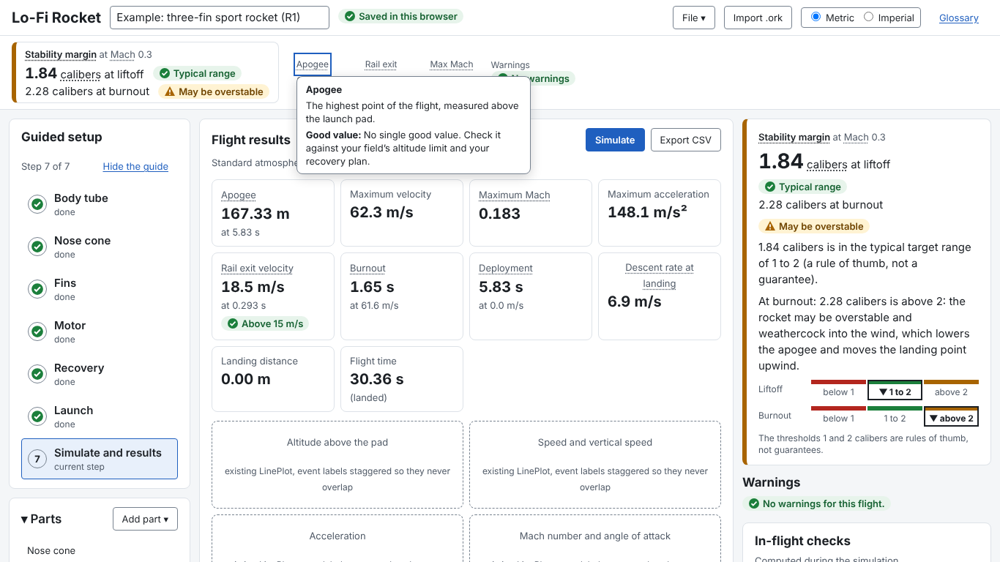

## 5. Warnings

### Rules

1. **Always visible.** Every current warning is in the checks column on every screen, and the status bar shows the counts and the most serious title. A warning is never only inside an editor, a collapsed panel or a scrolled area.
2. **Never dismissible.** There is no close button. **Acknowledge** records that the user has read it and shows "Acknowledged" next to it; the text, colour, icon and position do not change (tested: the list's text is identical apart from that word). A warning goes away only when its cause goes away.
3. **Each with its reason.** A warning has a short title (what happened), a one-sentence reason (why it matters, CLAUDE.md 9) and an optional detail line (source, decision, setting to change). Today's messages are split at their first colon with the words unchanged; where a message has no colon the whole message is the title and the reason is the existing sentence that follows it.
4. **Severity in words, icon and colour.**

| Severity    | Icon                 | Means                                                                |
| ----------- | -------------------- | -------------------------------------------------------------------- |
| Danger      | octagon with a cross | the flight as designed could hurt someone or lose the rocket         |
| Caution     | triangle with a bar  | it works, with a reduced margin or a figure to check                 |
| Model limit | square with lines    | the result is outside the model's validated range or uses a fallback |
| Note        | circle with an i     | state and provenance: an import, stale results, recovered autosave   |

5. **No safety warning becomes harder to see.** Today every warning is a yellow box inside a panel that may be scrolled or closed. In the redesign each is at least as large, in a column that cannot be closed, with a stronger colour for danger. The tests check that every warning keeps its full text.
6. **Order:** danger, caution, model limit, note; within a severity, the order the app gives.

### Where every current notice goes

| Notice (review inventory)                                                                                                                                                        | Severity                                   | Place                                                                     |
| -------------------------------------------------------------------------------------------------------------------------------------------------------------------------------- | ------------------------------------------ | ------------------------------------------------------------------------- |
| Stability unstable (liftoff or burnout)                                                                                                                                          | Danger                                     | stability card tag and frame; warning list; status bar                    |
| Stability overstable                                                                                                                                                             | Caution                                    | same                                                                      |
| Stability "Cannot compute" with the physics error                                                                                                                                | Danger                                     | stability card (error state); status bar                                  |
| `no-recovery` (also shown at design time once the design has none)                                                                                                               | Danger                                     | warning list; recovery step "needs attention"                             |
| `rail-exit-velocity` below the threshold                                                                                                                                         | Danger                                     | warning list; status on the rail exit result card                         |
| `deployment-velocity` above the threshold                                                                                                                                        | Danger                                     | warning list; status on the deployment result card                        |
| `rail-angle-above-nar-limit`                                                                                                                                                     | Danger                                     | warning list at design time; inline under the rail angle field            |
| `thrust-to-weight` below the threshold                                                                                                                                           | Caution                                    | warning list                                                              |
| Motor wider than the mount tube                                                                                                                                                  | Caution                                    | warning list at design time; inline in the motor step                     |
| `max-time` (stopped before landing)                                                                                                                                              | Caution                                    | warning list; flight time card                                            |
| `transonic`, `supersonic` and every physics `model` warning (drag and CP regimes, digitised nose data, held values, angle of attack beyond the drag scaling, normal force limit) | Model limit                                | warning list; status on the maximum Mach card                             |
| `model-limit` (flight ended at 90°)                                                                                                                                              | Model limit                                | warning list; flight time card                                            |
| Imported drag curve in use                                                                                                                                                       | Model limit                                | warning list; "How this was computed"; a tag on every result card's group |
| Simulation could not run, with the reason                                                                                                                                        | Danger                                     | results step, in place of the results; status bar                         |
| Monte Carlo run errors and failed runs                                                                                                                                           | Caution                                    | Monte Carlo panel and warning list                                        |
| Stale results                                                                                                                                                                    | Note                                       | every result card, the status bar, the plots                              |
| Recovered autosave, opened and imported notices (with the `.ork` notices)                                                                                                        | Note                                       | warning list, with the file name                                          |
| ThrustCurve, cache and file import status lines; stored-motor problems                                                                                                           | Note or Caution as today's wording implies | motor step, inline                                                        |
| Field validation messages; wind profile error                                                                                                                                    | inline error                               | under the field (`Field`, `NumberInput`), announced                       |
| Method note of the stability card; thresholds as rules of thumb                                                                                                                  | text                                       | stability card                                                            |
| The modes line (integrator, degrees of freedom, roll reduction, base drag rule, gravity, drag curve, turbulence seed, flat non-rotating Earth)                                   | text                                       | "How this was computed" in the results view, unchanged                    |
| "Select a motor before simulating"; "Add a tube first"; "No warnings."                                                                                                           | text                                       | the step that needs it; warning list's empty text                         |

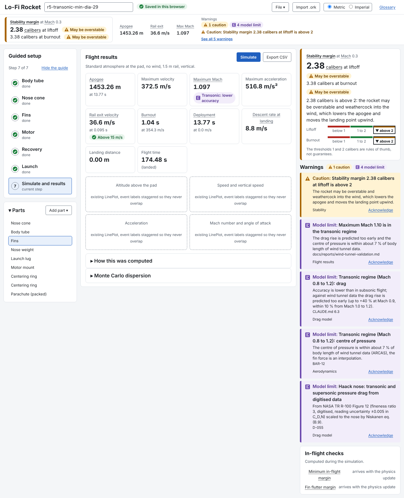

## 6. Space for the features of the other sessions

| Feature (session)                            | Place reserved                                                                                                       | State until it lands                                  |
| -------------------------------------------- | -------------------------------------------------------------------------------------------------------------------- | ----------------------------------------------------- |
| 3D viewer (3D session)                       | "3D view" tab next to "Side view" in the main view; the same CG and CP legend underneath                             | tab present, panel says where it comes from           |
| Minimum in-flight stability margin (physics) | In-flight checks panel in the checks column, a `ResultCard` with a status tag; also a status bar item once it exists | "simulate to see" / "arrives with the physics update" |
| Fin flutter margin (physics)                 | In-flight checks panel, same form                                                                                    | same                                                  |
| Validated-range warnings (physics review)    | the warning list as Model limit items; a status on the result card concerned (as maximum Mach shows)                 | the current regime warnings already use it            |

The glossary already has entries for the minimum in-flight margin and the fin flutter margin; their good-value lines say the threshold will come with its source, and must be completed when the physics lands.

## 7. Visual system and accessibility

### Spacing, type, shape

- Spacing: a 4 px grid, `--lfr-space-1` to `--lfr-space-7` = 4, 8, 12, 16, 24, 32, 48 px.
- Type scale (size / line height, px): caption 12/16, small 13/18, body 15/22, heading 17/24, title 20/28, key figure 28/34. Numbers use tabular figures.
- Radius 4 px for controls, 8 px for panels and cards. Controls at least 32 px tall; every target at least 24 × 24 px (SC 2.5.8).

### Colour tokens

Defined once in `packages/ui/src/tokens/tokens.ts` and as CSS variables in `tokens.css` (light by default, dark from the system setting or `data-theme="dark"`; the app sets dark unless the user chose light, D-UI-6). A test checks the two files agree. The dark values were refitted on 2026-10-13 to colours sampled from the owner's reference image; a `neutralIndicator` (#6b7192 light, #8b91b3 dark) marks finished checklist steps.

| Token                        | Light                       | Dark                        | Use                                   |
| ---------------------------- | --------------------------- | --------------------------- | ------------------------------------- |
| bg / surface / surfaceSunken | #eef0f7 / #ffffff / #f3f4fa | #12152b / #181b38 / #0e1124 | page, panels, insets                  |
| text / textMuted             | #161a33 / #535978           | #f3f4fb / #9fa3c7           | text, labels and units                |
| borderSubtle / borderControl | #dde0ee / #7a809f           | #272b52 / #6d72a3           | dividers (decorative) / control edges |
| accent, focus                | #1f5fd1                     | #4b97ff, #8ab8ff            | links, selection, focus ring          |
| safe text / bg / indicator   | #166232 / #e7f4eb / #1b7f3b | #7be3a4 / #11291f / #3fd47f | OK, typical range                     |
| caution                      | #6f4400 / #fff3d3 / #a86400 | #ffcb6b / #2c2414 / #f7a128 | Caution                               |
| danger                       | #9c1f18 / #fdeceb / #c62a22 | #ff9d9d / #341823 / #ff5d5d | Danger                                |
| info                         | #1a4b93 / #e8f0fb / #1f5fd1 | #a9c9ff / #152349 / #4b97ff | Note                                  |
| limit                        | #55358f / #f2edfa / #6b47ad | #cdb8ff / #251e47 / #ad8bff | Model limit                           |
| cgMarker / cpMarker          | #1b4f9c / #c62a22           | #4b97ff / #ff6b6b           | side view markers                     |

Colour for meaning is always paired with an icon of its own shape and a word (`SeverityTag`, `WarningBanner`, `StabilityIndicator`, `StepGuide`); the stability zones are labelled with their threshold numbers and the current zone is outlined and pointed at, so they read in grey scale.

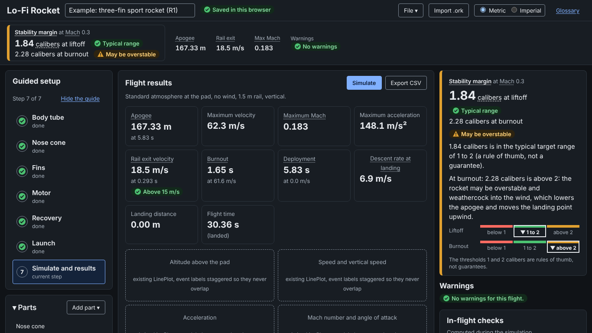

### Accessibility (WCAG 2.2 AA)

- **Contrast:** 27 token pairs per theme are tested: text at least 4.5:1 (SC 1.4.3), indicators, focus ring and control edges at least 3:1 (SC 1.4.11). The test implements the WCAG relative-luminance and contrast-ratio definitions and is itself checked against black on white (21:1) and #767676 on white (4.54:1).
- **Keyboard:** everything is reachable with Tab in reading order (header, status bar, navigation, main, checks), with a "Skip to the main view" link first. Tabs use arrow keys, Home and End; dialogs trap focus, close with Escape when dismissible and return focus; tooltips open on focus and close with Escape; collapsible panels are buttons with `aria-expanded`. File pickers are real buttons (`FileButton`), so no focus stop is invisible. The side view keeps the parts list as its keyboard equivalent.
- **Focus:** a 2 px focus ring with a 2 px offset on every interactive element (SC 2.4.7, 2.4.11), in the accent colour, 3:1 against both surfaces.
- **Names and announcements:** landmarks with names (banner, Status region, Design steps navigation, main, Checks and warnings); field errors are `role="alert"` and describe their field; the warning list is a polite live region; result values that are missing are spoken as "not available".
- **Tests:** axe-core runs on every component in jsdom (contrast off there, because jsdom does not lay out; the token test covers it) and on the whole shell with the landmark rule on.

## 8. Display formatting rules (one place)

`packages/ui/src/format/display-rules.ts` is the one documented place for decimals and unit labels:

- `UNIT_DISPLAY`: the label and decimals of every quantity kind in metric and imperial. Identical to `packages/app/src/units/display.ts` today; a test reads that file and fails if they differ.
- `FIGURE_DISPLAY`: every other fixed rounding the app applies (stability margin 2, C_Nα 2, maximum Mach 3, time to apogee 2, rail exit time 3, burnout and deployment time 2, flight time 2, event time 3, landing bearing 0, total impulse 2 or 1 in lists, average thrust 1 in lists, burn time 2, recorded apogee difference 1, run time 0), each with the file and line it comes from; a test checks each line still has that `toFixed`.
- `formatFixed` is `Number.prototype.toFixed`, so rounding is bit-for-bit what the app does now. Non-finite values are written out ("NaN", "Infinity") and marked, never shown as a number or a blank.
- `editText` is the text of an editable field: today's rule, except that a value it would misstate (a non-zero value shown as 0, or more than 0.1 % off) is shown with six significant digits (D-UI-3).
- Unit conversion factors are not in the UI package: they are physics (UNIT-5 to UNIT-11) and stay in the app, which passes the library values already in the display unit.

When the app adopts the library, `units/display.ts` takes its labels and decimals from `UNIT_DISPLAY` and the panels' `toFixed` calls are replaced by `formatFigure`. The warning messages built in `packages/formats` with their own `toFixed` and always in metric (review finding 9) should carry their numbers as data instead; that is a formats change, proposed in D-UI-4.

## 9. Before and after

| Screen                                            | Before (current app)                   | After (rendered from `packages/ui`)    |
| ------------------------------------------------- | -------------------------------------- | -------------------------------------- |
| Design, example rocket                            | 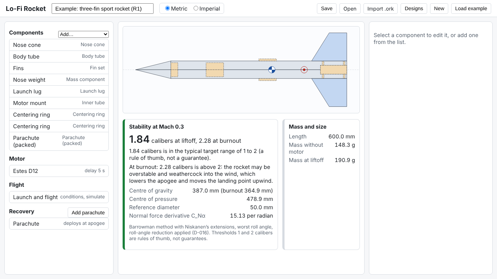          |           |
| New rocket, unstable, invalid entry, stale flight | 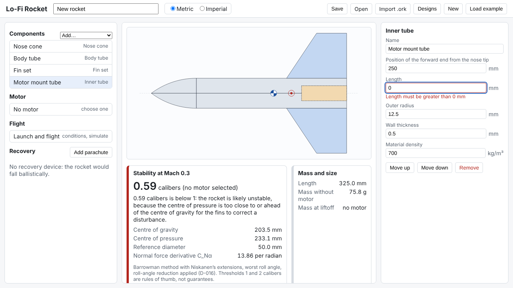       |         |
| Motor                                             | 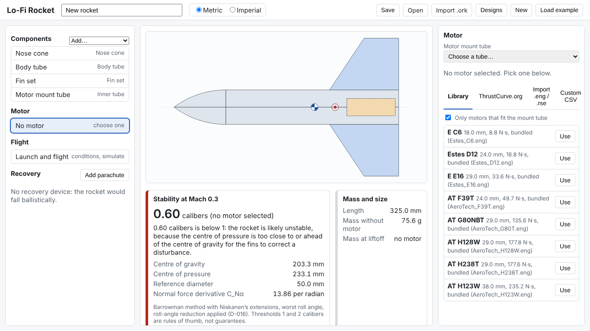         | 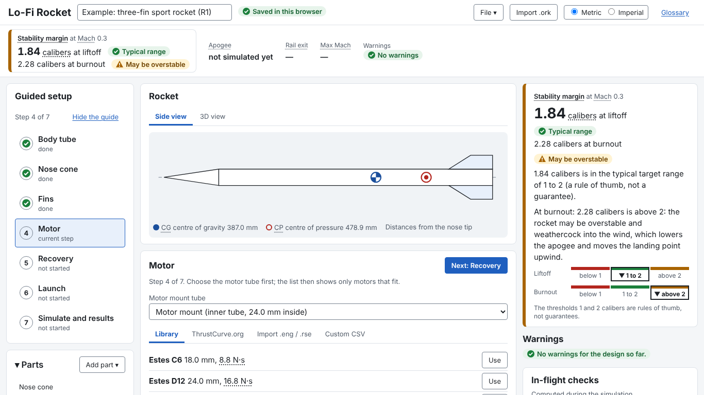           |
| Results, example                                  | 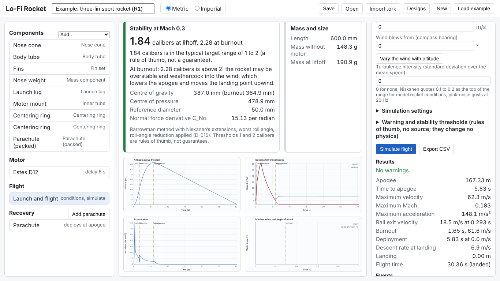               | 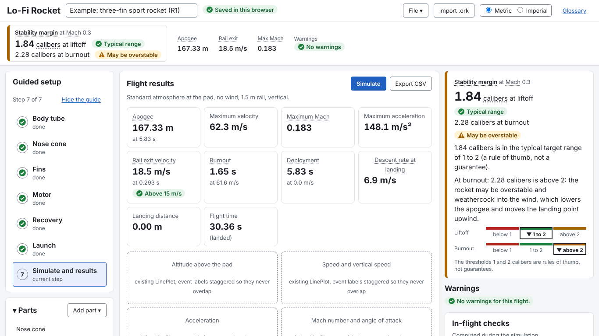         |
| Results with warnings (R5)                        | 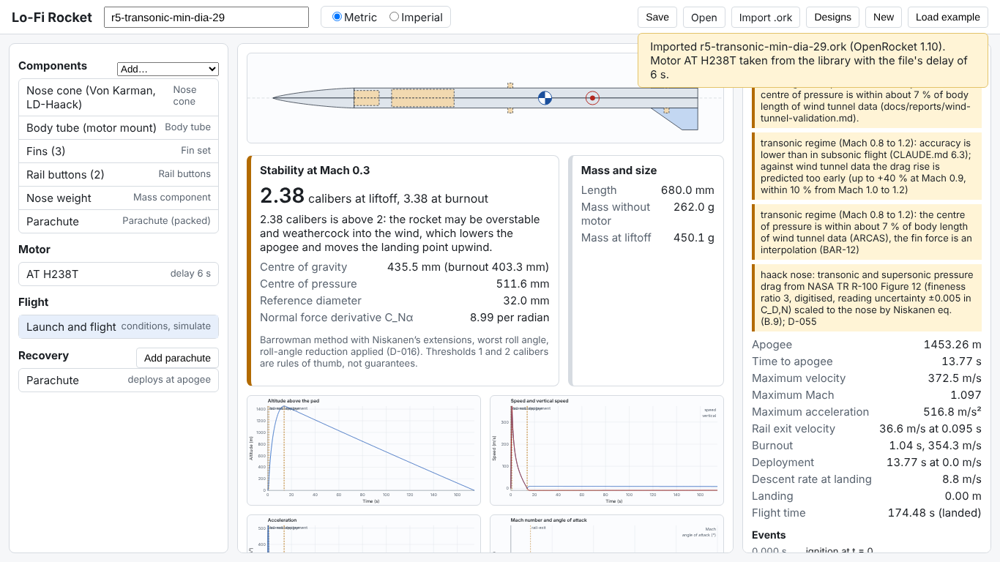 | 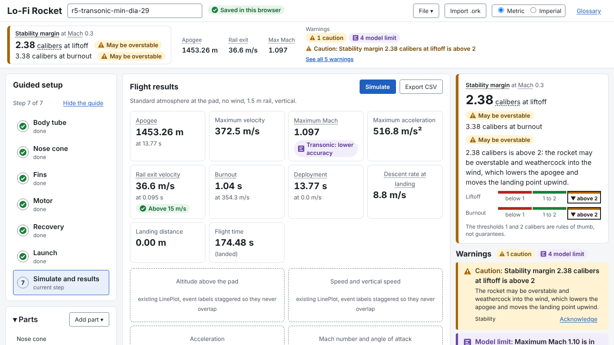       |
| 1024 px window                                    | 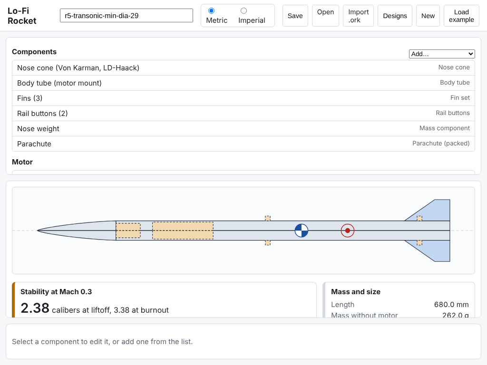       | 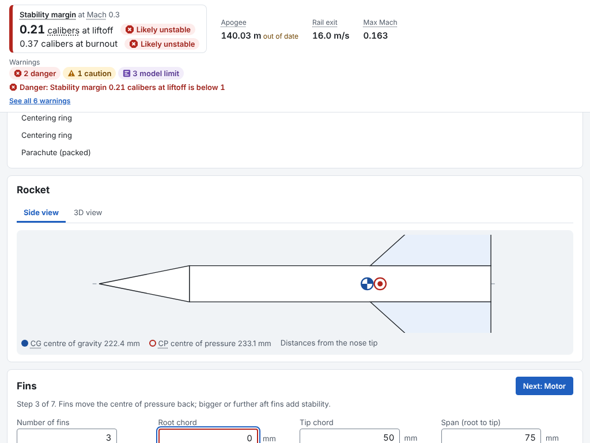 |
| Dark theme                                        | none                                   | 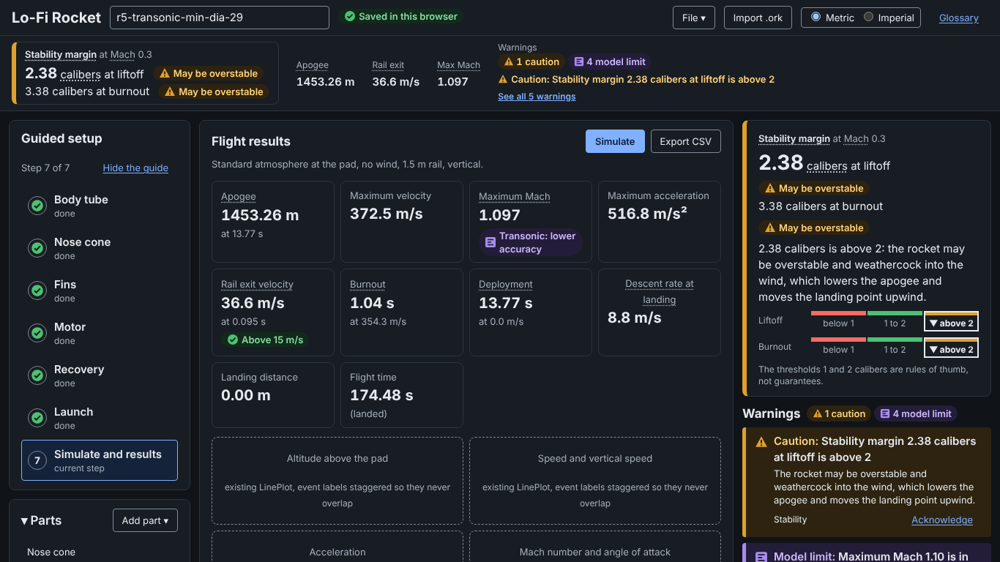  |

The after images are screenshots of `packages/ui/mockups/`, a page built only from the library's components, rendered by `tools/ui-walkthrough/mockups.js`. Their figures and warning texts are copied from the current app's display of the same rockets (`packages/ui/mockups/data.ts`); none is computed. The side view and plots are placeholders for the app's existing `SideView` and `LinePlot`, which the apply prompt keeps (with the label and tick fixes of review finding 25).

## 10. Open questions for the owner

1. **Default ejection delay** (review finding 10): today the first delay in the motor's list is selected, which can be 0 s. Options: keep it and show it prominently (the redesign does this either way); select the longest delay; leave the delay empty until the user chooses. Recommendation: leave it unset until chosen, with Simulate explaining why it is disabled. This changes behaviour, so it waits for the owner.
2. **Warnings as data** (D-UI-4): may `designFlightWarnings` return the title, reason, numbers and units separately, so that warnings follow the units setting and the display rules? It changes `packages/formats`, owned by another session now.
3. **Static margin at Mach 0.3:** when the minimum in-flight margin lands, should the status bar show it next to the static margin, or instead of it after a flight? Recommendation: next to it, both labelled.

## 11. Mapping for the apply prompt

| Current (`packages/app`)             | Replaced by (`packages/ui`)                                            |
| ------------------------------------ | ---------------------------------------------------------------------- |
| `App` layout, `Header`, `FilesMenu`  | `AppShell`, `Button`, `FileButton`, `Dialog` for replace-design        |
| `ComponentList`                      | `StepGuide` and a parts list                                           |
| `StabilityPanel`, `MassPanel`        | `StabilityIndicator` (full and compact), `ResultGrid`                  |
| `QuantityField`, `IntegerField`      | `NumberInput` (values converted by the app's `unitFor`)                |
| editors' `<select>`s and text inputs | `SelectField`, `TextField`                                             |
| `.warning` paragraphs everywhere     | `WarningList` in the checks column, `WarningSummary` in the status bar |
| `FlightPanel` summary                | `ResultCard`s in the results step                                      |
| Motor picker tabs                    | `Tabs`                                                                 |
| `
` sections                 | `Panel collapsible`                                                    |
| labels with technical terms          | `Term`                                                                 |

## 12. Applied as an instrument console (2026-10-13)

The owner asked for the app to look like their reference image, a spacecraft "Vehicle overview" console: clean, new, refined, adapted where needed. The plan above was applied in that look.

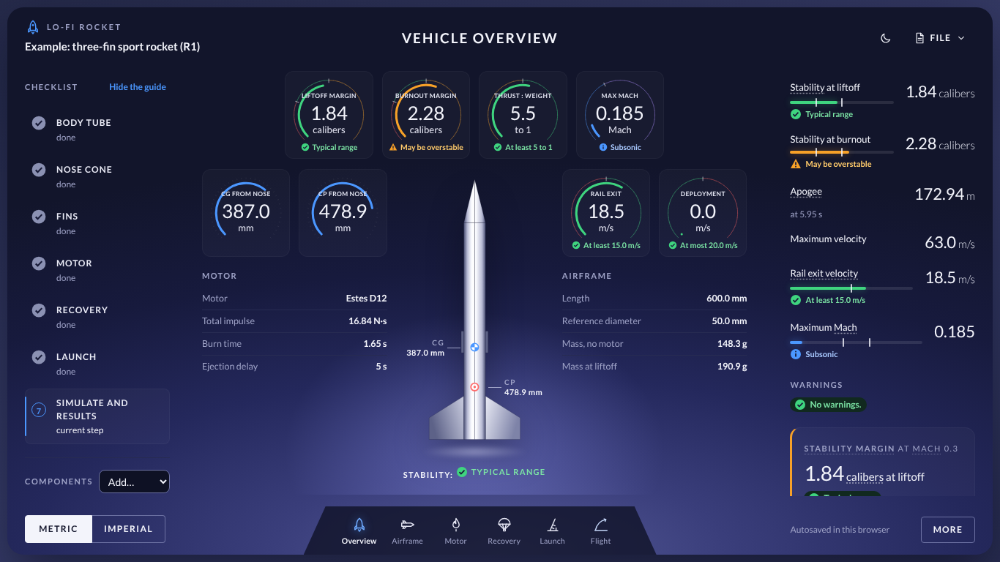

| Reference                                     | Here                                                                                                                                                                           |
| --------------------------------------------- | ------------------------------------------------------------------------------------------------------------------------------------------------------------------------------ |
| One screen on a deep indigo field with a glow | The console: the page never scrolls on a laptop or larger; each column scrolls on its own. Below 1100 px the columns stack, checks first (section 2).                          |
| "Vehicle overview" title                      | The open view's name, centred over the main column.                                                                                                                            |
| Checklist with check circles, on the left     | The guided steps (section 3): a neutral check when done, a caution mark when a step needs attention, the number while not started; the parts list under it.                    |
| Dial tiles around the vehicle                 | Stability at liftoff and burnout, thrust to weight, maximum Mach, CG and CP from the nose, rail exit and deployment velocity, each with its status in words (D-UI-7).          |
| The vehicle, large, in a spotlight            | The rocket standing nose up, drawn from the side-view geometry and shaded as a lit cylinder, with the CG and CP marked and labelled. Clicking a part opens it.                 |
| "Connections" table                           | Motor and Airframe tables: motor, total impulse, burn time, ejection delay; length, reference diameter, masses.                                                                |
| Readouts with thin bars, on the right         | The always-visible status (section 2): stability, apogee, maximum velocity, rail exit velocity, maximum Mach; then every warning, the stability card and the in-flight checks. |
| Systems / Cabin switch                        | Metric / Imperial.                                                                                                                                                             |
| Icon dock                                     | The views: Overview, Airframe, Motor, Recovery, Launch, Flight. The open view is marked in the accent colour, not red, which means danger here (D-UI-6).                       |
| More                                          | Theme and the full glossary.                                                                                                                                                   |

| Screen                    | Image                                   |
| ------------------------- | --------------------------------------- |
| Overview, before a flight | 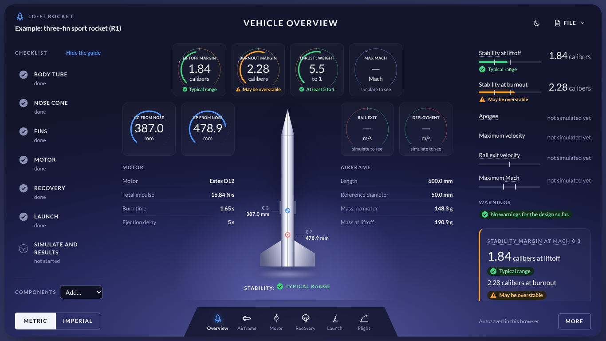       |
| Airframe, fins selected   | 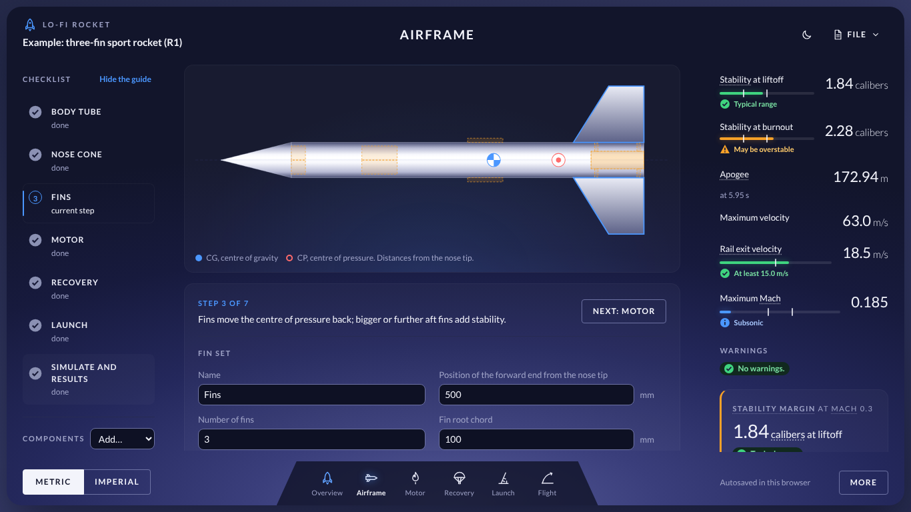       |
| Flight results            | 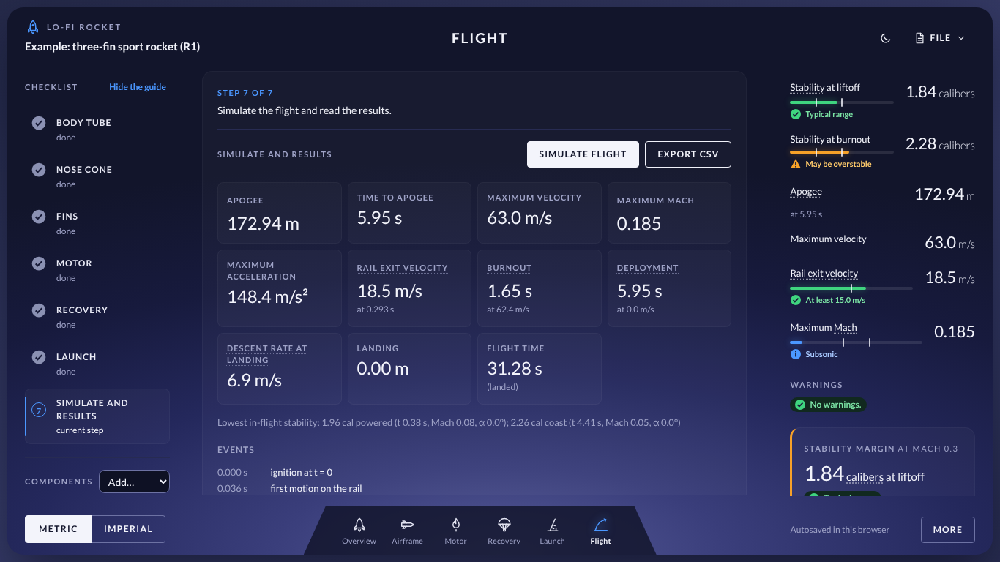         |
| Light theme               | 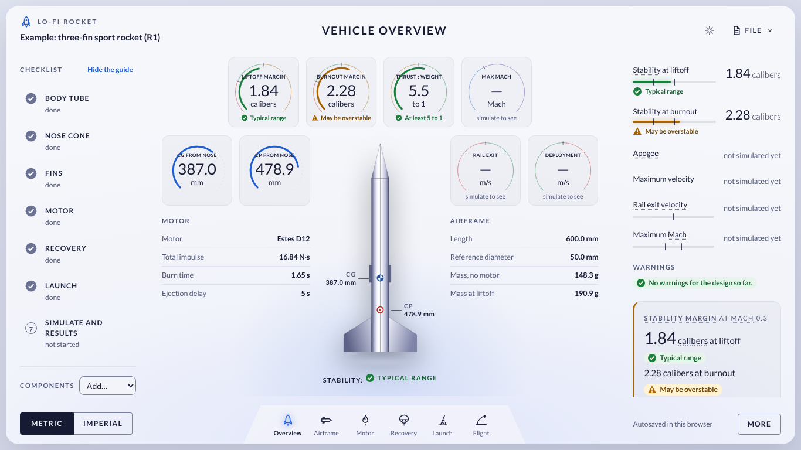 |
| 1920 × 1080               | 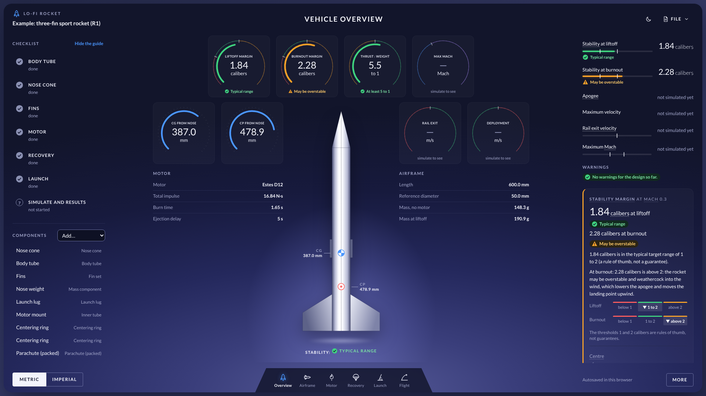  |

Not yet done from this plan: replacing the editors' own fields with `NumberInput` and `SelectField` (they are restyled, not rebuilt), the replace-design confirmation dialog, and the structured warnings of D-UI-4 (a `packages/formats` change). The 3D replay's sky is drawn by `packages/viewer` in a fixed light colour; that is the 3D lane's to theme.
