# Usability review of the current app

**Date:** 2026-10-12. **App version:** `claude/inspiring-tesla-xxp0hh` at 109d117 (Prompt 5 complete).
**Method:** the built app (`vite preview`) driven in Chromium at a 1366 × 768 laptop viewport by `tools/ui-walkthrough/walkthrough.js`, following the tasks a new user would try: start a rocket from scratch, edit components, choose a motor, set up a launch, simulate, read the results, run Monte Carlo, import an `.ork` file, save and reload. A screenshot was saved at each step in `docs/ui/review/`; extra figures were read from the running app with Playwright. Plan UI-0001.

The app is accurate and honest: it shows its sources, its limits and its warnings. The problems below are about finding, reading and trusting what it shows. They are ranked by how much they hurt a new user. The top group comes first because it can mislead a safety decision or hide a value the simulator produced, which matters more than convenience.

Each finding gives the screenshot, what happens, why it matters, and the fix in the redesign (section numbers refer to `docs/ui/redesign.md`). Nothing here was changed in `packages/app`: the owner asked for the review and the design first, with the screens changed in a later prompt.

## Rank 1: can mislead a safety decision or hides a value

### 1. Results from a different rocket stay on screen

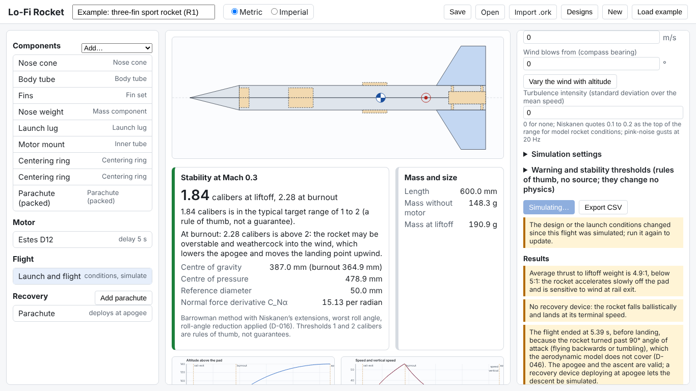
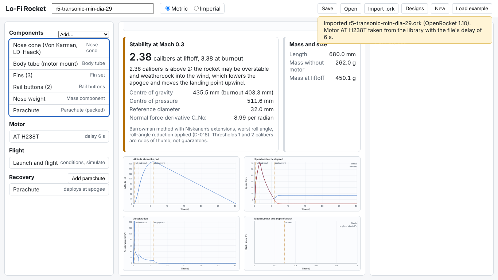

After **Load example**, **New**, **Open** or **Import .ork**, the previous flight's results stay visible: the summary, the events, "No warnings." and all four plots. A one-line notice above the results says the design changed, but it scrolls out of view with the panel, and the plots in the centre carry no notice at all. In screenshot 21, R5 (a 1.4 km transonic rocket) sits above R1's 167 m altitude plot. A new user can read the old rocket's apogee, and the old "No warnings.", as belonging to the new design.

**Fix:** results belong to a design. Replacing the design clears them; editing marks every figure "out of date" on the card itself and in the status bar (sections 2, 5; `ResultCard stale`).

### 2. Flight results are cut off at the panel edge

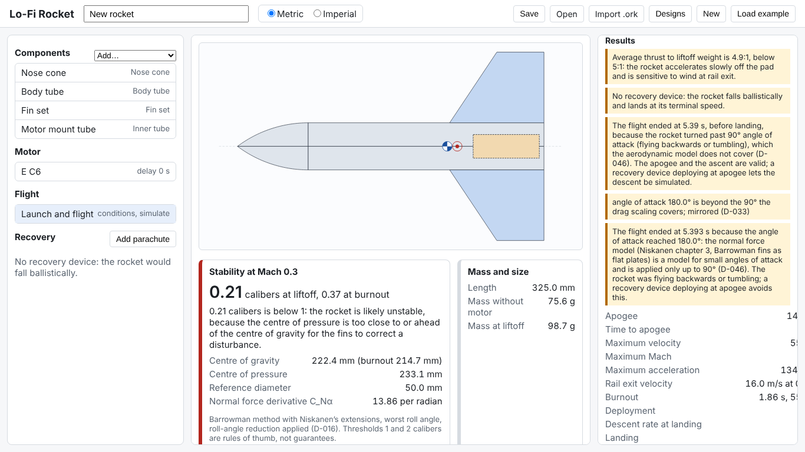

When the warnings are long, the results list widens past the 340 px right column and the values are clipped: "Apogee 14…", "Maximum velocity 5…", "Rail exit velocity 16.0 m/s at (". The numbers exist but cannot be read without resizing the window.

**Fix:** values wrap and never overflow (`overflow-wrap: anywhere` on every value, cards in a grid in the wide main view, section 2).

### 3. Monte Carlo results are cut off

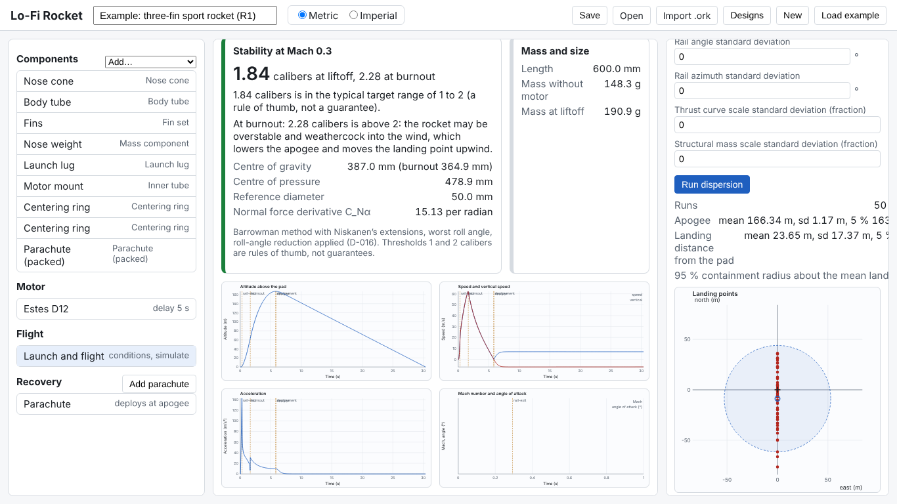

The dispersion summary is one long line per figure ("mean 166.34 m, sd 1.17 m, 5 % 163…"); most of it, the 95 % containment radius and the seed are off the edge of the panel.

**Fix:** one result card per statistic in the main view (section 2).

### 4. A tolerance of 1e-8 is shown as 0

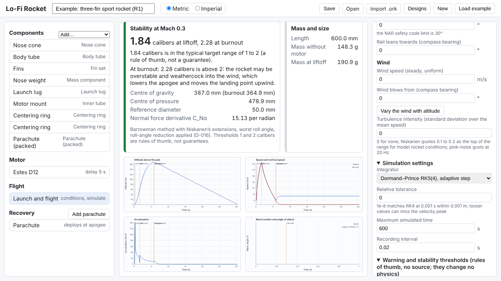

The Dormand–Prince relative tolerance field shows **0**. The design holds 1e-8; the field rounds every value to at least three decimals (`QuantityField.tsx:35`). A user who believes the tolerance is 0, or who edits the field, is misled about the setting.

**Fix:** the edit-text rule never shows a non-zero value as 0 (`editText`, D-UI-3; tested).

### 5. The Mach and angle-of-attack plot is empty

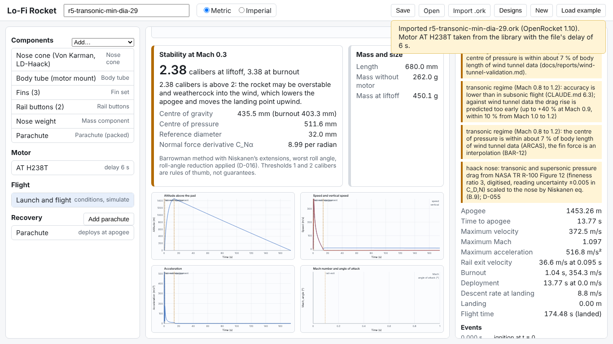

The fourth plot shows axes from 0 to 1 and no line, for R1 (Mach 0.18) and for R5 (Mach 1.10). In `LinePlot.tsx:44-60` an empty frame of 0 to 1 is drawn when the computed range is not finite; `Math.max` with a NaN gives NaN, so at least one sample of the Mach or angle-of-attack series is probably not a finite number. The plot fails silently, against CLAUDE.md 8. This needs confirming in the physics or app code (not changed here) and is listed for the follow-up.

**Fix:** plots must say when a series holds a non-finite value instead of drawing an empty frame (section 8; the library's components write non-finite values out and mark them).

### 6. The stability colour follows liftoff only

R1 is 1.84 calibers at liftoff (typical, green) and 2.28 at burnout (above 2, possibly overstable). The card is green and only the second paragraph mentions burnout. In screenshot 22, R5 is overstable at both and the card is orange, so the colour does mean something, but it hides a change at burnout.

**Fix:** liftoff and burnout each get their own status tag with icon and words, and the frame takes the more serious of the two (`StabilityIndicator`, section 5).

### 7. Every warning looks the same, whatever its weight

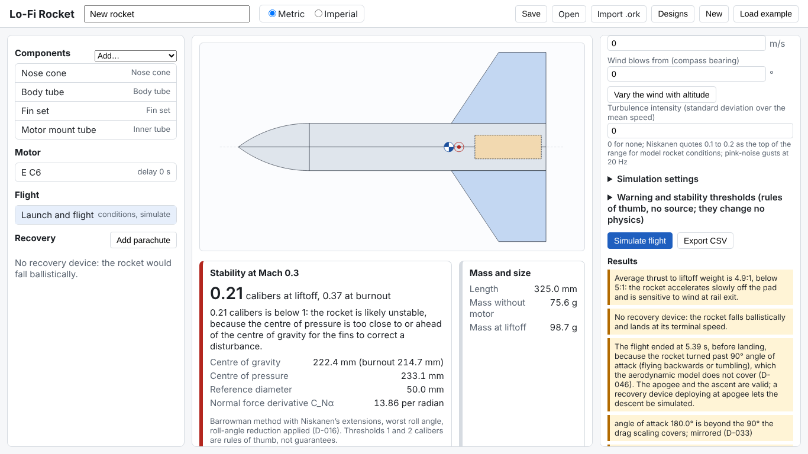

"No recovery device: the rocket falls ballistically" (the rocket comes down at terminal speed), "Average thrust to liftoff weight is 4.9:1" (a margin) and "angle of attack 180.0° is beyond the 90° the drag scaling covers; mirrored (D-033)" (a model note) all have the same yellow box. A new user cannot tell which one could hurt someone.

**Fix:** four severities, each with its own icon, word and colour: Danger, Caution, Model limit, Note (section 5). None of them can be dismissed.

### 8. Design-time warnings disappear when another panel is open

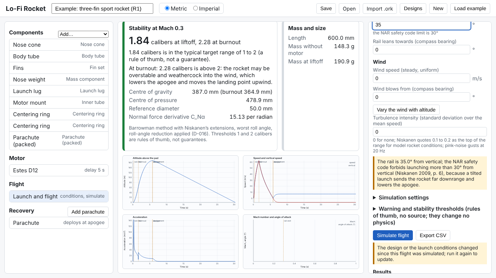

The NAR 30° rail angle warning and the motor-too-wide warning appear only inside the Launch or Motor editor. Select a fin set and they are gone until a flight is simulated. "No recovery device" appears only after a simulation (the component list says it in grey).

**Fix:** a checks column that is visible on every screen and lists every current warning, design-time and flight (sections 2, 5).

### 9. The same value is rounded twice, and warnings ignore the unit setting

The transonic warning says "Maximum Mach 1.10"; the summary says 1.097. The rail exit and deployment warnings write m/s in Imperial mode, because the messages are built with their own `toFixed` in `packages/formats/src/design/to-physics.ts`. Decimals are decided in at least four places.

**Fix:** one table of display rules (`packages/ui/src/format/display-rules.ts`, section 8). Warnings should carry their numbers and units as data so the app can format them by the table; that needs a change in `packages/formats`, proposed for the follow-up prompt (D-UI-4).

### 10. The default ejection delay can be 0 s

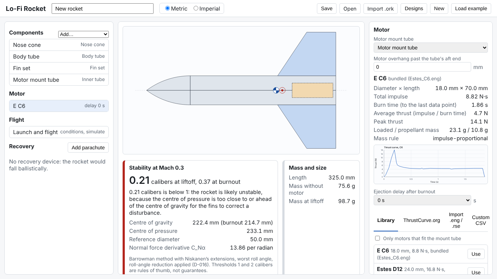

Choosing the Estes C6 selects the first delay in its list, 0 s: the charge fires at burnout, at full speed. The app warns after a simulation if deployment is faster than the threshold, but a new user does not know that the delay was chosen for them.

**Fix:** the motor step shows the delay next to the time to apogee of the last flight and says what 0 s means (`after-motor.png`). Whether the default should change is a behaviour question for the owner (open question 1 in section 10).

## Rank 2: blocks or seriously confuses a main task

### 11. The Simulate button is below the fold

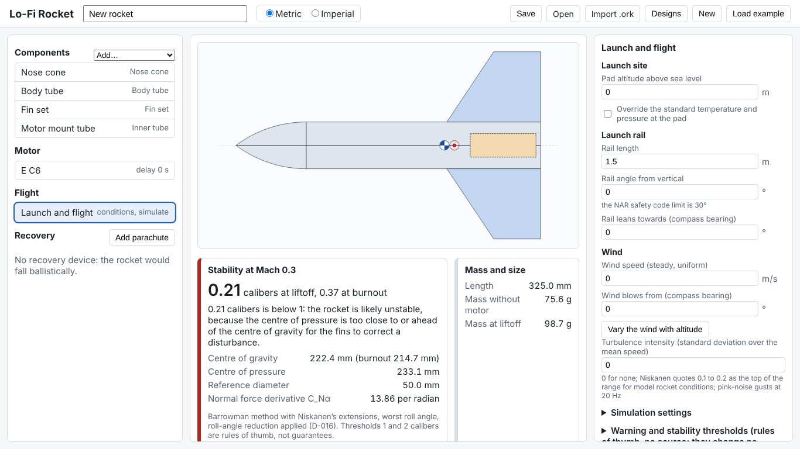

Opening "Launch and flight" shows the launch site, rail, wind and two collapsed sections. **Simulate flight** is below, and the right panel must be scrolled to find it.

**Fix:** Simulate is the primary action of the results step and is always in its header (section 3).

### 12. There is no order to follow, and the defaults start unstable

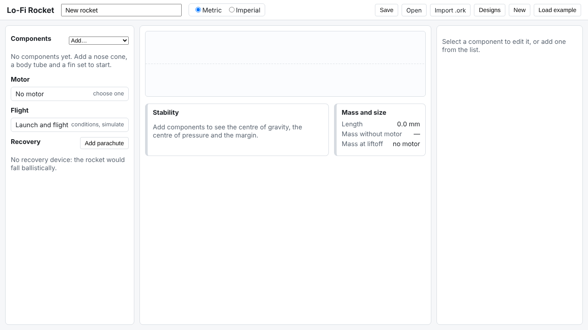
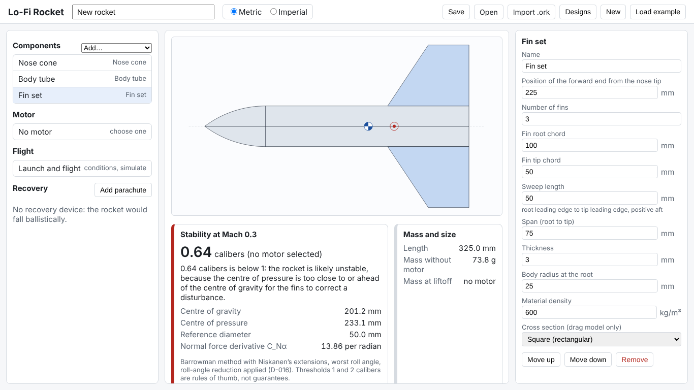

After **New** the list says "Add a nose cone, a body tube and a fin set to start", but the parts are added from a native drop-down with eleven entries, and the motor, flight and recovery items are separate lists. The default nose, tube and fins give 0.64 calibers, so the first thing a new user sees is a red "likely unstable".

**Fix:** a guided path (body tube, nose cone, fins, motor, recovery, launch, simulate and results) that any step can be opened from and that experienced users can hide (section 3). Each step says what it changes ("bigger or further aft fins add stability").

### 13. The motor mount is not chosen and the picker is visible before it is

The mount tube starts at "Choose a tube…" even when there is one inner tube, and the library lists every motor, including ones that will not fit. Once a tube is chosen the filter applies.

**Fix:** the motor step asks for the mount first and says why (section 3).

### 14. The motor source tabs overflow the panel

"Import .eng / .rse" wraps to three lines and "Custom CSV" runs past the right edge.

**Fix:** tabs wrap as a row (`Tabs`, tested with the same four labels).

### 15. One panel holds launch, results, imports and Monte Carlo

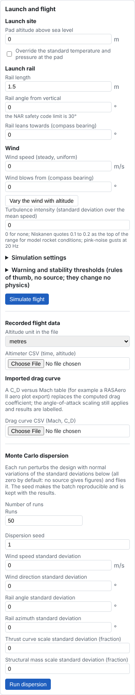

"Launch and flight" is about 1,800 px tall: launch site, rail, wind, settings, thresholds, Simulate, results, events, recorded flight import, drag curve import and Monte Carlo, in one 340 px column.

**Fix:** launch is one step; results get the main view; recorded data, drag curve and Monte Carlo are one click away in collapsible panels of the results view (section 2).

### 16. File notices cover the screen and never close

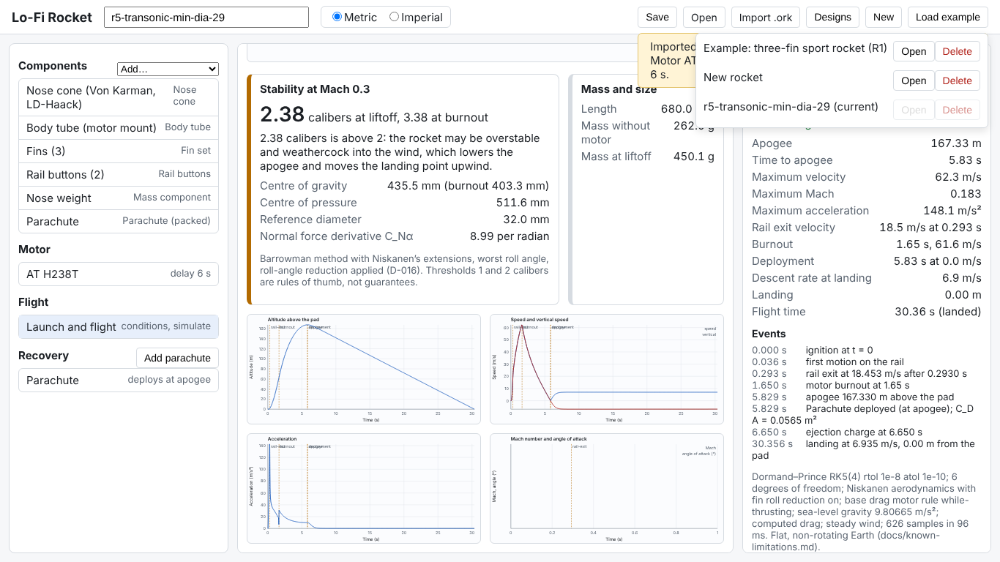

After an import, the notice floats over the top right of the panels and stays until the page is reloaded. The Designs list opens on top of it.

**Fix:** import notices are Notes in the checks column, like any other notice; the file menu is a single menu (section 2).

### 17. An invalid entry keeps the old value silently

Typing 0 in a length shows "Length must be greater than 0 mm", which is right, but the side view and stability keep using the previous length and nothing says so.

**Fix:** the message adds "Not applied: still using 70 mm." (`NumberInput`, tested).

### 18. The CG and CP markers are not labelled

The side view shows a blue-and-white disc and a red ring with a dot. Nothing says which is the CG and which the CP.

**Fix:** a legend under the side view with both positions and the glossary terms (`after-design.png`).

### 19. Internal references and jargon in user-facing text

The screens show C_Nα, "D-016", "D-046", "D-033", "BAR-12", "eq. (B.9)", "CLAUDE.md 6.3" and file paths such as `docs/reports/wind-tunnel-validation.md`. Several model warnings start with a lower-case word ("haack nose:", "transonic regime", "angle of attack"). Experienced users need the references; new users need the plain sentence first.

**Fix:** each warning has a title, a one-sentence reason, then the reference as a smaller detail line (section 5). Every technical term gets a glossary tooltip (section 4).

### 20. One event, two warnings

When the rocket tumbles, the flight end is reported twice: once by the design warnings ("ended at 5.39 s … (D-046)") and once by the physics ("ended at 5.393 s because the angle of attack reached 180.0° …").

**Fix:** the redesign keeps both texts (none may be dropped) but groups them under the same origin. Merging them is a change to `packages/formats`, listed as a follow-up (D-UI-4).

### 21. "Stability at Mach 0.3" is not explained

The heading gives a Mach number without saying why. For R5, which flies to Mach 1.10, a new user can read the static margin as the margin throughout the flight.

**Fix:** "Stability margin at Mach 0.3" with both terms explained, and a reserved place for the minimum in-flight margin (section 6).

### 22. At 1024 px the key numbers go below the fold

Below 1100 px the three columns stack with the component list first; the stability card is half visible and the editor is at the very bottom.

**Fix:** the status bar stays at the top and the checks column comes directly after it (`after-problems-narrow-full.png`).

## Rank 3: friction

### 23. Keyboard focus disappears on two header stops

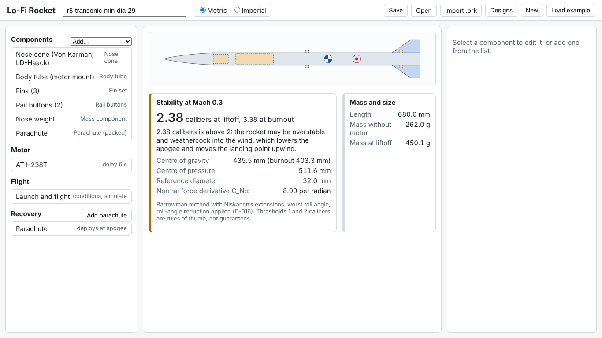

Tabbing through the header puts focus on the invisible file inputs behind **Open** and **Import .ork**: two stops with no visible focus. The side view can be used only with a mouse. The tab order is design name, units, Save, (Open), (Import), Designs, New, Load example, Add, the component list, the motor, the flight item and the recovery list.

**Fix:** `FileButton` (a real button; the input is out of the Tab order), a skip link to the main view, and the parts list as the keyboard path to what the side view selects (section 7).

### 24. Six header buttons with the same weight; New does not confirm

Save, Open, Import .ork, Designs, New and Load example look the same. **New** replaces the design at once. It is autosaved, but nothing says so or where it went.

**Fix:** one File menu, a "Saved in this browser" status, and a confirmation dialog for replacing the design (`Dialog`).

### 25. Plot labels overlap and are small

Event labels on the plots overlap ("rail-exit" and "burnout", "apogee" and "deployment") and the tick labels are about 8 px at this size.

**Fix:** staggered event labels and tick text at the caption size (section 7).

### 26. Smaller inconsistencies

- The dispersion panel labels the run count twice ("Number of runs" over "Runs"), and the outer label points at no input (screenshot 26).
- Motor names mix the manufacturer's abbreviation and name: "E C6" next to "Estes D12" (screenshot 06).
- "Landing 0.00 m" has no direction, while a non-zero distance gets one; correct, but it reads like missing data.
- The thresholds section title wraps over three lines (screenshot 09).
- The stability card is cut at the bottom of the centre panel at 768 px when a long editor is open (screenshot 04).
- No dark theme.

## What works well and must be kept

- The stability guidance sentences, the "rules of thumb, not guarantees" wording and the editable thresholds.
- Inline validation messages in plain language ("Fin root chord must be greater than 0 mm").
- The modes line under the results, which says exactly how the flight was computed.
- The stale-results notice (it only needs to be impossible to miss).
- Autosave, the recovered-autosave notice and the units toggle.

## Inventory of warnings and notices the app shows today

Every item below needs a place in the new design; `docs/ui/redesign.md` section 5 gives each its severity and its place.

| Source                             | Notice                                                                                                                                                                                                                                                                                |
| ---------------------------------- | ------------------------------------------------------------------------------------------------------------------------------------------------------------------------------------------------------------------------------------------------------------------------------------- |
| `designStability` (formats)        | unstable, typical, overstable assessments at liftoff and burnout; "Cannot compute" with the physics error; the empty state                                                                                                                                                            |
| Stability panel                    | the method note (Barrowman with Niskanen's extensions, worst roll angle, roll reduction D-016) and "thresholds are rules of thumb"                                                                                                                                                    |
| `designFlightWarnings` (formats)   | `rail-exit-velocity`, `thrust-to-weight`, `deployment-velocity`, `supersonic`, `transonic`, `no-recovery`, `max-time`, `model-limit`, and `model` (every physics warning of the flight)                                                                                               |
| Physics flight warnings (`model`)  | transonic and supersonic drag and CP accuracy, nose drag from digitised TR R-100 data (held values, late data starts), angle of attack beyond the drag scaling (D-033), normal force limit (D-046)                                                                                    |
| `validateLaunch` (physics)         | rail angle above the NAR 30° limit; launch validation errors                                                                                                                                                                                                                          |
| Launch editor                      | wind profile validation error; hints (NAR limit, turbulence range, integrator convergence, threshold sources)                                                                                                                                                                         |
| Motor panel                        | motor wider than the mount tube; stored-motor problems; "Add a body tube or an inner tube first"; no motor selected; every status line of ThrustCurve search, download, cache and import                                                                                              |
| Flight panel                       | "Select a motor before simulating"; "The simulation could not run" with the reason; the stale-results notice; "No warnings."; the modes line (integrator, degrees of freedom, roll reduction, base drag rule, gravity, imported drag curve, turbulence seed, flat non-rotating Earth) |
| Dispersion panel                   | the zero-variation explanation; run error; failed runs with the first message; the seed                                                                                                                                                                                               |
| Comparison panel                   | imported drag curve in use (results labelled); import status lines; recorded versus simulated apogee                                                                                                                                                                                  |
| Files and autosave                 | invalid autosave kept aside as `recovered:<id>`; opened and imported notices with the `.ork` conversion notices; file errors                                                                                                                                                          |
| Component list and recovery editor | "No recovery device: the rocket would fall ballistically"; the parachute drag coefficient hint (Niskanen p. 67)                                                                                                                                                                       |
| Every number field                 | the validation messages                                                                                                                                                                                                                                                               |

## Screenshots

All in `docs/ui/review/`, numbered in walkthrough order: 01 first load (example), 02 new design, 03 nose added, 04 fins added, 05 invalid field, 06 motor panel, 07 library filtered, 08 motor selected, 09 launch editor, 10 and 11 results of the starter rocket, 12 recovery editor, 13 example loaded with stale results, 14 plots, 15 NAR warning, 16 stale notice, 17 settings open, 18 Monte Carlo, 19 Imperial, 20 fins removed (−5.70 calibers), 21 `.ork` import, 22 R5 flight warnings, 23 Designs list, 24 keyboard focus, 25 1024 px window, 26 the whole flight panel, 27 R5 plots.
