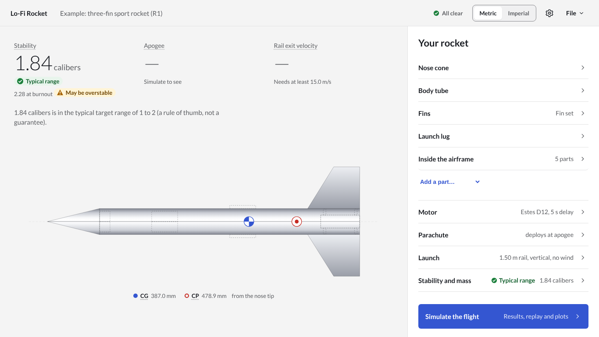
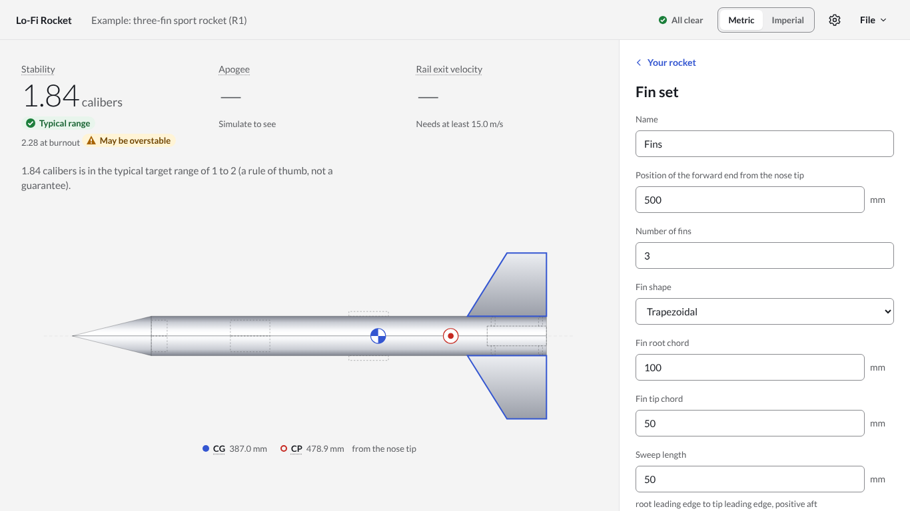
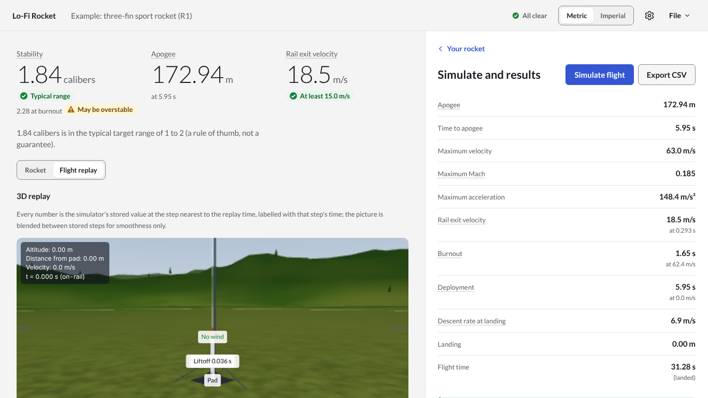
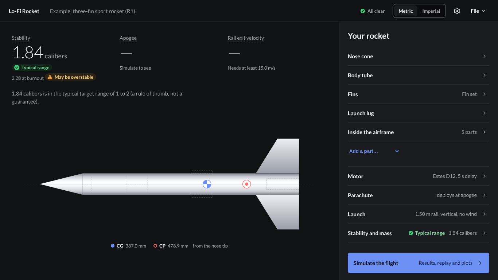
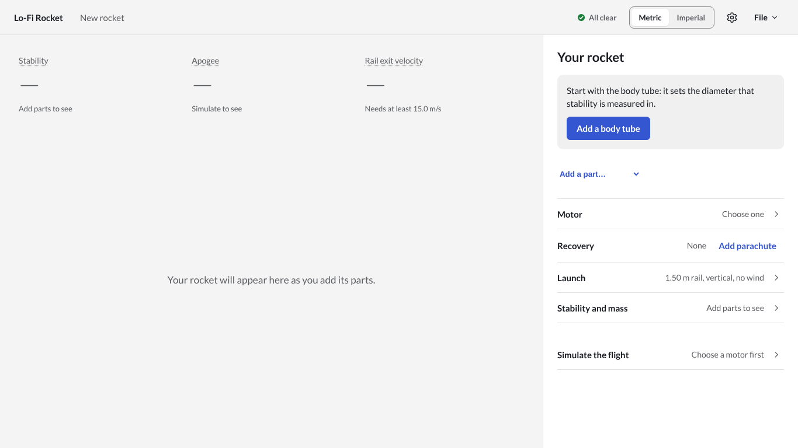
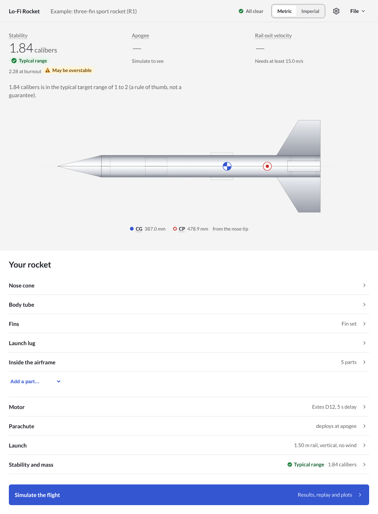

# Simplification plan

**Date:** 2026-10-13. Plan UI-0002; decisions D-UI-11 to D-UI-14 in `docs/ui/decisions.md`.
**Input:** the owner's review of the console (PR #52): "very cluttered; far simpler, cleaner, easier to understand, less bunched up; simple and brutally effective, like Tesla; usability first."
**Replaces:** the console layout of `redesign.md` section 12. Sections 1 (principles), 4 (terms), 5 (warning rules), 7 (accessibility) and 8 (display rules) of `redesign.md` still hold.

## 1. What made the console cluttered

| Problem                                | Where                                                                                  |
| -------------------------------------- | -------------------------------------------------------------------------------------- |
| Everything on screen at once           | three full columns, a dock, a title bar and a footer, all at the same time             |
| The same figure in many places         | stability margin in 2 dials, 2 bars, the stability card, the caption and the checklist |
| Decoration doing the work of layout    | dial rings, zone rings, tick marks, glows, gradients, a bezel                          |
| Two ways to navigate                   | a checklist and a parts list on the left, a dock at the bottom                         |
| Labels shouting                        | small capitals and letter spacing on almost every label                                |
| Numbers with no natural scale on dials | CG and CP as dials, deployment velocity before any flight                              |

## 2. Principles

1. **One rocket, one task.** The screen shows the rocket and the one thing being done to it. Nothing else.
2. **Three numbers.** Stability, apogee and rail exit velocity decide whether a flight is safe and worth flying. They are always on screen, large. Every other figure is one tap away.
3. **Quiet when fine, unmissable when not.** When nothing is wrong the app says "All clear" once, in small type. When something is wrong, every warning is shown in full at the top of the task panel on every page, and the top bar says how many (redesign section 5, unchanged: never dismissible, never only in a closed panel).
4. **No decoration.** Flat surfaces, one accent colour, no gradients, rings or glows. Colour only for status, always with an icon and a word.
5. **Plain words, sentence case.** Small capitals only for the few section labels.
6. **Big targets, one way to get anywhere.** Every part of the design is a row in one list; tapping a row opens it; a back button returns.

## 3. Layout

```
┌───────────────────────────────────────────────────────────────────────────┐
│ Lo-Fi Rocket  Example: three-fin sport rocket    ● All clear  Metric|Imperial  ⚙  File │
├──────────────────────────────────────────────┬────────────────────────────┤
│                                              │  (warnings, when any)      │
│                                              │                            │
│      ═══════════[ rocket ]══════════▶        │  Your rocket               │
│            ● CG         ○ CP                 │   Nose cone            ›   │
│                                              │   Body tube            ›   │
│   1.84 calibers     172.94 m     18.5 m/s    │   Fins                 ›   │
│   Typical range     Apogee       Rail exit   │   Motor   Estes D12    ›   │
│                                              │   Recovery  Parachute  ›   │
│   1.84 calibers is in the typical range...   │   Launch               ›   │
│                                              │   [ Simulate the flight › ]│
└──────────────────────────────────────────────┴────────────────────────────┘
```

- **Top bar:** product name, the design name (editable), the warning status, units, settings, File.
- **Stage (left):** the rocket on its side, large, drawn from the side-view geometry; the CG and CP marked; the three numbers under it, each with its status in words; one plain sentence from the physics about the stability margin. After a simulation the stage shows the 3D replay instead, with a switch back to the rocket.
- **Task panel (right):** the warnings when there are any, then one page:
  - **Your rocket** (home): one list of every part, the motor, recovery, launch, stability and mass, and the flight. Each row says what it is in a few words.
  - **A part, the motor, recovery, launch:** its editor, with "Back" at the top.
  - **Flight:** Simulate, the results as a plain list, the plots, the events, the comparison with a recorded flight and the Monte Carlo dispersion.
  - **Stability and mass:** the full stability card, the in-flight checks, mass and size, and the rocket as built (its weighed mass and balance point, D-089).
- **Below 1100 px:** top bar, stage, warnings, task panel, one under the other.

## 4. Theme

Neutral and flat: near-white or near-black surfaces, one blue accent, status colours only for status. The theme follows the system (light or dark) unless the user picks one in Settings. Every token pair still meets WCAG 2.2 AA (D-UI-2).

## 5. Removed

The dial tiles, the telemetry bars, the dock, the checklist column, the overview tables, the More dialog's duplicate of the glossary entry point (Settings has it), the bezel, the glow. The UI library loses `Gauge`, `Meter`, `Dock`, `StepGuide` and `StatusItem`; `AppShell` becomes header, stage, checks and main.

## 6. Tests

- The 3D lane's `FlightViewer` tests run unchanged: the "Flight" list is on the home page, the "Imperial" switch is in the top bar, and the replay and "Run dispersion" are on screen together after a simulation.
- App tests follow the new pages; end-to-end tests check that the three numbers, the warning status and the rocket are on screen at 1366 × 768 without scrolling.

## 7. Screens

| Screen                          | Image                          |
| ------------------------------- | ------------------------------ |
| Home, 1366 × 768                |    |
| A part open (the fins)          |    |
| After a flight: replay, results |  |
| Dark (system setting)           |    |
| A new design                    |     |
| 1024 px wide, stacked           |  |
